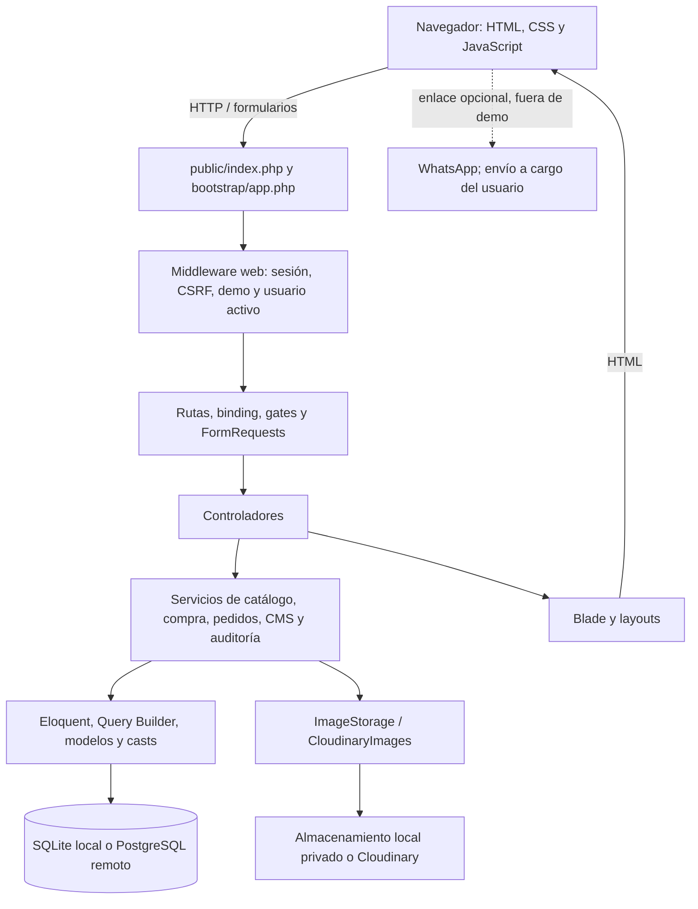
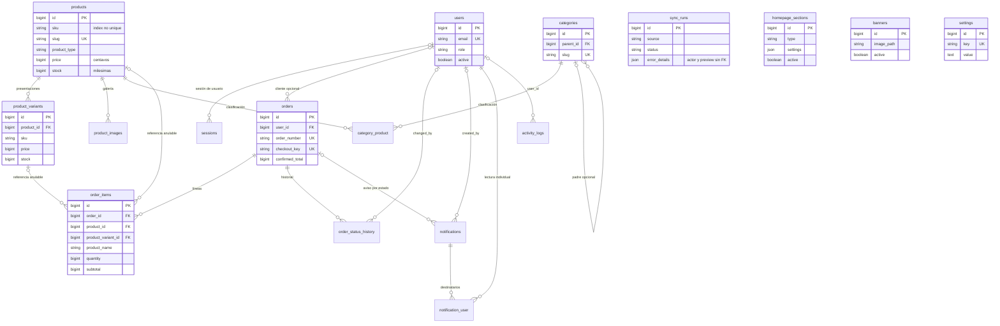
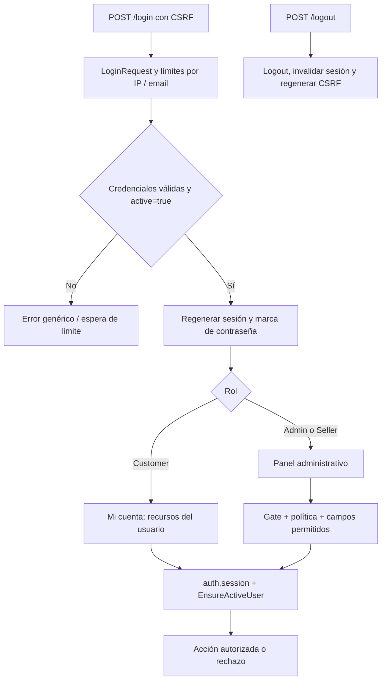
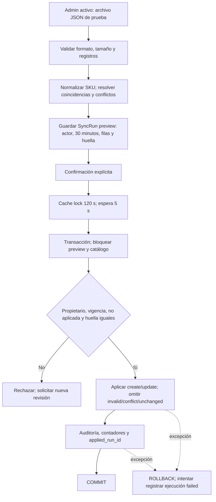
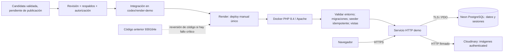

# Manual Técnico y de Programación de Ferretería El Nuevo Sol

Versión consolidada de las fuentes en `docs/manual-tecnico/`.

Versión documental 1.0, revisión 3. Fecha de actualización: 6 de noviembre de 2026.

La revisión 3 añade el estado local de la ronda administrativa en `codex/admin-corrections`, sobre la candidata af85ee7. Tarjetas, editor integrado, guardado progresivo y ajustes de WhatsApp son cambios locales posteriores; no se atribuyen a la validación PostgreSQL histórica ni a la demo publicada. Los apartados añadidos con el título «Ronda administrativa local» prevalecen para esos recorridos sobre la descripción de la candidata base.

Este manual describe la versión candidata del repositorio, no una versión comercial ya conectada al punto de venta. Está dirigido a desarrolladores que deban instalar, comprender, mantener o extender el sistema y a evaluadores académicos.

## Referencia y método

- Repositorio: https://github.com/marcosanchavarro-glitch/FerreteriaElNuevoSol
- Rama de referencia: `codex/validation-phase18-19`.
- Revisión documental de referencia: `af85ee7a6e1179ac77757a72c9f05b17bc9983bf`.
- Código validado en PostgreSQL: `de5f43681f6117e39c8226a0c0ab040ce55a2952`. El commit posterior `af85ee7` solo incorpora documentación.
- Base de comparación: `codex/render-demo`, commit `939164e3b71ccf14c4ffe5dcd64cf98c362aa818`, última publicación confirmada en el historial de trabajo del 15/10/2026. No se consultó nuevamente Render para redactar este manual; no se certifica el estado remoto actual.
- No hay una rama local llamada `main` en el inventario consultado. No se atribuye ese nombre a la rama de publicación ni se infiere la rama predeterminada remota a partir del nombre.
- El informe local `docs/pendientes-correcciones.md` ya tenía cambios aprobados sin commit al comenzar esta tarea. Se usa como evidencia de la revisión focalizada, separada de la evidencia de CI.

Se leyeron rutas, migraciones, modelos, políticas, solicitudes, controladores, servicios, layouts, recursos estáticos, manifiestos, pruebas y configuración de despliegue. La primera revisión fue exclusivamente documental. En la ronda local posterior se ejecutaron pruebas focalizadas en SQLite en memoria y comprobaciones de guardado sobre productos ficticios locales, documentadas en docs/correcciones-administracion.md. No se ejecutaron migraciones sobre datos persistentes, instalaciones ni despliegues. Los comandos operativos se documentan para su uso posterior; su presencia no indica ejecución durante la redacción.

**Estados empleados:** implementado con cobertura y validación histórica; implementado pendiente de publicación; parcial (infraestructura de datos o código presente sin recorrido completo); pendiente (sin implementación comprobada). La existencia de una prueba no equivale a una ejecución reciente. Las versiones y fechas de evidencia se detallan en el capítulo 16.

## Índice

1. [Introducción](manual-tecnico/01-introduccion.md)
2. [Arquitectura de software](manual-tecnico/02-arquitectura.md)
3. [Tecnologías y herramientas](manual-tecnico/03-tecnologias.md)
4. [Organización del proyecto](manual-tecnico/04-organizacion.md)
5. [Instalación y configuración](manual-tecnico/05-instalacion.md)
6. [Base de datos](manual-tecnico/06-base-datos.md)
7. [Autenticación, roles y seguridad](manual-tecnico/07-seguridad.md)
8. [Módulo de productos](manual-tecnico/08-productos.md)
9. [Catálogo público](manual-tecnico/09-catalogo.md)
10. [Carrito y checkout](manual-tecnico/10-carrito-checkout.md)
11. [Gestión de pedidos](manual-tecnico/11-pedidos.md)
12. [Panel administrativo](manual-tecnico/12-panel.md)
13. [CMS y personalización](manual-tecnico/13-cms.md)
14. [Sincronización por SKU](manual-tecnico/14-sincronizacion.md)
15. [Integraciones externas](manual-tecnico/15-integraciones.md)
16. [Pruebas y control de calidad](manual-tecnico/16-pruebas.md)
17. [Despliegue](manual-tecnico/17-despliegue.md)
18. [Respaldos y recuperación](manual-tecnico/18-respaldos.md)
19. [Mantenimiento y resolución de problemas](manual-tecnico/19-mantenimiento.md)
20. [Estado actual y evolución](manual-tecnico/20-evolucion.md)

Los anexos incluyen [diccionario de datos](manual-tecnico/anexos/diccionario-datos.md), [inventario y trazabilidad](manual-tecnico/anexos/inventario.md), [configuración](manual-tecnico/anexos/configuracion.md) y [glosario y referencias](manual-tecnico/anexos/glosario-referencias.md). Los seis diagramas mantenibles se encuentran en `diagramas/`; también se incluyen en la versión consolidada.

## Mantenimiento documental

La fuente editable está organizada en capítulos y anexos. El generador `recursos/consolidar.py` concatena esas fuentes e inserta los diagramas en `docs/MANUAL-TECNICO-EL-NUEVO-SOL.md`, ajustando enlaces relativos. No analiza ni ejecuta Laravel. Después de modificar capítulos, ejecutarlo con Python 3 desde cualquier directorio y revisar el resultado.

El formato Word es opcional. En el entorno inspeccionado hay biblioteca de escritura DOCX, pero no se encontró un renderizador DOCX disponible entre las herramientas inspeccionadas para verificar páginas y diagramas sin instalaciones adicionales. Por ello esta revisión entrega Markdown completo y no un Word sin validación visual.

---

# 1. Introducción

## 1.1 Presentación y problema

Ferretería El Nuevo Sol es una aplicación web para presentar un catálogo, recibir solicitudes de productos con retiro en local y administrar su preparación. Atiende la diferencia entre artículos con precio calculable y artículos cuyo importe requiere confirmación, así como unidades fraccionables y presentaciones comerciales. El sistema conserva el contenido editorial de la tienda separado de los datos comerciales susceptibles de importación.

El problema abordado es la dispersión entre la consulta del catálogo, el armado de una solicitud y el seguimiento interno. La solución registra un pedido persistente con copia de sus condiciones, aun cuando luego cambien los productos. No reemplaza la caja, la facturación ni la contabilidad del establecimiento.

## 1.2 Objetivos

El objetivo general es ofrecer un recorrido web coherente desde la búsqueda hasta el seguimiento del pedido, con controles de acceso y trazabilidad. Sus objetivos específicos son administrar productos simples y variables; publicar categorías e imágenes; calcular cantidades sin errores de coma flotante; conservar pedidos e historial; personalizar el inicio; y preparar una importación comercial identificada por SKU sin sobrescribir contenido editorial.

## 1.3 Alcance y usuarios

El visitante puede navegar, filtrar productos y utilizar el carrito y checkout sin cuenta. Customer dispone de perfil, pedidos propios y notificaciones internas. Seller accede al panel y a operaciones permitidas por políticas; Admin añade edición comercial local, configuración, auditoría e importación. No existe un formulario público para registrarse como Admin.

La entrega incluye catálogo, autenticación, productos, variantes, categorías, imágenes, carrito de sesión, checkout, pedidos, notificaciones internas, CMS, auditoría y motor manual de importación. Las mejoras de Dashboard/Pedidos y el motor manual son parte de la candidata pendiente de publicación según el último estado confirmado.

## 1.4 Limitaciones

Solo existe retiro en local (`pickup`). No hay pasarela de pagos, cálculo de envíos, facturación, descuento o reserva automática de stock ni envío de pedidos al punto de venta. WhatsApp se utiliza mediante un enlace que debe abrir y enviar el usuario; en modo demo se suprime ese enlace. El correo real no está habilitado en la configuración entregada. La integración con Soluciones Es requiere documentación y transporte todavía no implementados. Los respaldos recuperables no están acreditados y condicionan el despliegue autorizado.

Fuentes principales: `backend/routes/web.php`, `backend/app/Enums/`, `backend/app/Services/Storefront/Checkout.php`, `backend/app/Services/Storefront/WhatsAppOrder.php` y `docs/pendientes-correcciones.md`.

---

# 2. Arquitectura de software

## 2.1 Monolito renderizado en servidor

La aplicación ejecutable está en `backend/`. Laravel organiza un monolito MVC: recibe HTTP, valida y autoriza solicitudes, coordina servicios, consulta Eloquent/Query Builder y renderiza HTML mediante Blade. No hay una SPA ni una API pública de sincronización. Los formularios y enlaces realizan solicitudes normales; cambiar de sección administrativa provoca recarga de documento.

La vista usa HTML, CSS y JavaScript estáticos. El navegador no se conecta directamente a PostgreSQL ni conoce las credenciales de Cloudinary. JavaScript mejora la galería, cantidades y selección de variantes; el servidor sigue siendo responsable de autorización, precio y stock admisible.

## 2.2 Responsabilidades

| Capa | Ubicación | Responsabilidad |
|---|---|---|
| Entrada | `public/index.php`, `bootstrap/app.php`, `routes/web.php` | Arranque, middleware, rutas y manejo de errores |
| Solicitudes | `app/Http/Requests` | Normalización, autorización de campos y validación |
| Controladores | `app/Http/Controllers` | Coordinar un caso de uso y producir vista o redirección |
| Servicios | `app/Services` | Carrito, checkout, catálogo, imágenes, estados, CMS, auditoría e importación |
| Dominio/persistencia | `app/Models`, `app/Enums`, `app/Casts` | Relaciones, estados tipados e invariantes de representación |
| Autorización | `app/Policies`, `AppServiceProvider` | Políticas por entidad y gates de acceso |
| Presentación | `resources/views`, `public/css`, `public/js` | HTML escapado, estilos y comportamiento progresivo |

No todas las escrituras pasan por un único servicio: `ProductController` contiene su transacción y el registro de auditoría. La separación existente debe documentarse como tal, sin atribuir repositorios, buses o microservicios que no existen.

## 2.3 Ciclo de una solicitud

Una petición llega a Apache en el contenedor o al servidor de desarrollo. `public/index.php` carga Composer y la aplicación configurada en `bootstrap/app.php`. El grupo web administra cookies, sesión y CSRF. `DemoAccess` agrega las reglas de demo; `EnsureActiveUser` controla cuentas desactivadas. Las rutas privadas agregan `auth`, `auth.session` y gates. El binding resuelve entidades; en relaciones anidadas se utiliza `scopeBindings()`.

El FormRequest valida antes del método del controlador. Una operación de escritura abre la transacción necesaria, aplica reglas y registra auditoría cuando corresponde. Blade escapa la salida y genera formularios con CSRF. Después de escribir, el controlador suele redirigir a una ruta nombrada: este patrón evita volver a presentar directamente el resultado de un POST. La validación HTML muestra errores; solicitudes que esperan JSON reciben respuestas del framework. No implica que exista una API REST dedicada.

## 2.4 Comunicación y decisiones técnicas

SQLite facilita ejecución local sin un servicio de base separado; PostgreSQL permite persistencia remota y bloqueos de filas verificados. Los casts enteros mantienen el mismo significado monetario entre ambos motores. Render ejecuta PHP/Apache; Neon aloja datos y sesiones; Cloudinary mantiene imágenes que no pueden depender del disco efímero. Estas son ventajas del diseño observado, no una reconstrucción de decisiones históricas no registradas.

Diagrama: [arquitectura general](manual-tecnico/diagramas/01-arquitectura.mmd).

Fuentes: `backend/bootstrap/app.php`, `backend/app/Providers/AppServiceProvider.php`, `backend/Dockerfile`, `backend/config/database.php` y los layouts Blade.

## 2.5 Decisión de evolución: responsabilidades comerciales previstas

Se conserva Laravel como plataforma principal. Para la integración futura, Punto de Venta será la fuente de precios y stock; los pedidos se gestionarán en la web y la facturación se realizará por separado en Punto de Venta. Esta distribución de responsabilidades es una decisión de arquitectura prevista, no una conexión implementada ni una automatización de facturación.

El mecanismo de conexión con Soluciones Es sigue pendiente de definición con el proveedor. No se decide aquí transporte, frecuencia, autenticación ni tratamiento de conflictos. WooCommerce no constituye una decisión definitiva ni un requisito de la arquitectura prevista. El alcance actual del importador manual permanece descrito en el capítulo 14. Las mejoras propuestas y sus dependencias se detallan en el apartado 20.5.




---

# 3. Tecnologías y herramientas

## 3.1 Versiones y alcance de la evidencia

| Tecnología | Referencia verificable | Uso y precisión |
|---|---|---|
| PHP | Rama 8.4 en Dockerfile, CI y AGENTS; 8.4.26 local | Runtime objetivo; el parche de la imagen no está fijado |
| Requisito PHP del proyecto | `^8.3` en composer.json | No sustituye el objetivo 8.4 usado para validar; comprobar requisitos del lock |
| Laravel | `v13.33.0` en composer.lock | Framework HTTP, ORM, vistas, validación y transacciones |
| Composer | Imagen `composer:2` en Dockerfile; 2.10.3 local | Instalación desde lock; parche no fijado por el repositorio |
| Tinker | `v3.0.2` en composer.lock | Consola de desarrollo; no parte del recorrido público |
| PHPUnit | `12.5.35` en composer.lock | Pruebas unitarias y funcionales |
| Pint | `v1.32.1` en composer.lock | Formato PHP |
| Boost | `v2.10.0` en composer.lock | Herramientas de desarrollo; dependencia dev |
| PostgreSQL | `postgres:17` en CI; 17.11 en la ejecución histórica indicada en capítulo 16 | Parche de futuras ejecuciones puede variar |
| SQLite | PDO SQLite en desarrollo/CI; extensión local 3.53.4 | Versión de extensión consultada sin abrir una base; no está fijada en el manifiesto |
| Git | `2.55.0.windows.3` observado localmente | Versionado; no es requisito mínimo del proyecto |
| Blade | Incluido en Laravel 13.33.0 | Sin versión independiente |
| HTML/CSS/JavaScript | Recursos propios estáticos | No se asigna una versión de paquete a estándares del navegador |
| Render/Neon/Cloudinary/GitHub | Servicios SaaS | No poseen versión instalada fijada por este repositorio |

`composer.json` incluye también Faker, Mockery, Collision, Pail y Pao para desarrollo. El inventario anexo extrae las versiones resueltas de todas las dependencias directas del lock, sin confundir rangos admitidos con versiones instaladas.

## 3.2 Herramientas frontend presentes frente a herramientas utilizadas

`package.json` declara Vite `^8.0.0`, Tailwind `^4.0.0`, `@tailwindcss/vite`, `laravel-vite-plugin`, `concurrently` y el paquete opcional `@laravel/multiplex`. Su presencia procede de la estructura de herramientas del proyecto. Los layouts operativos usan `asset('css/...')` y `asset('js/...')`, no `@vite`. El Dockerfile de producción no ejecuta npm ni compila estos recursos. Por ello no debe exigirse Node para servir las pantallas actuales ni describirse la interfaz como construida con React, Vue o Tailwind sin revisar el uso efectivo.

## 3.3 Servicios y bibliotecas

El adaptador Cloudinary usa el cliente HTTP de Laravel y firma solicitudes con SHA-256; no aparece un SDK Cloudinary como dependencia directa de Composer. WhatsApp no requiere SDK: se construye una URL `wa.me`. Las tablas de cola no demuestran la existencia de un trabajador en producción; Render configura `QUEUE_CONNECTION=sync`.

Para instalar una copia reproducible se utiliza `composer install`, no `composer update`. La referencia oficial del framework es [Laravel 13](https://laravel.com/docs/13.x); las versiones exactas del proyecto se obtienen del lock y prevalecen sobre ejemplos de versiones posteriores.

---

# 4. Organización del proyecto

## 4.1 Árbol representativo

```text
Ferreteria El Nuevo Sol/
├── .github/workflows/verify.yml
├── render.yaml
├── README.md
├── reference/wordpress/            referencia histórica del frontend
├── docs/                          documentación de fases y manual
└── backend/
    ├── app/
    │   ├── Casts/ Enums/ Models/ Policies/ Rules/ Support/
    │   ├── Http/Controllers/{Auth,Account,Admin,Storefront}/
    │   ├── Http/Requests/ y Http/Middleware/
    │   ├── Providers/AppServiceProvider.php
    │   └── Services/{Audit,Catalog,Content,Orders,Storefront}/
    ├── bootstrap/app.php
    ├── config/
    ├── database/{migrations,factories,seeders}/
    ├── deploy/
    ├── public/{css,js,images}/
    ├── resources/views/{layouts,admin,storefront,account,auth}/
    ├── routes/{web.php,console.php}
    ├── storage/ y bootstrap/cache/
    ├── tests/{Feature,Unit}/
    ├── composer.json y composer.lock
    ├── package.json
    ├── phpunit.xml
    └── Dockerfile
```

La notación con llaves agrupa directorios hermanos, no representa nombres literales. `reference/wordpress` no se ejecuta como WordPress en el despliegue Laravel. `.tools` contiene recursos locales ignorados y no forma parte del contrato de instalación para otro desarrollador.

## 4.2 Puntos de entrada para mantenimiento

Para cambiar una regla de catálogo, comenzar por `CatalogQuery`, `ProductPresentation` y `CatalogRequest`. Para corregir el cálculo de una compra, revisar `Cart` y `Checkout`; el JavaScript no es la autoridad económica. Para cambiar una transición de estado, revisar `OrderStatus`, `OrderStatusRequest` y `OrderStatusService`. Para imágenes, seguir `ImageStorage` y `CloudinaryImages`, además de los gestores de galería/CMS. Para importación, empezar por `CommercialSyncController` y `CommercialSyncService`.

`public/images/branding/logo-primary.png` y `tools-pattern.png` son recursos versionados de marca. Las imágenes cargadas por usuarios son privadas y sus rutas se guardan en datos; no deben añadirse al repositorio. `storage` contiene logs y archivos de ejecución. `bootstrap/cache` aloja configuración y manifiestos generados.

## 4.3 Documentación heredada

Los documentos de fases registran el estado en su fecha. Por ejemplo, `app/Services/README.md` todavía habla de servicios previstos desde Fase 2, aunque los servicios ya existen. El manual utiliza el código de la revisión fijada como fuente principal y conserva la documentación anterior sin reescribirla. El [inventario](manual-tecnico/anexos/inventario.md) permite localizar componentes y archivos de prueba concretos.

---

# 5. Instalación y configuración

## 5.1 Requisitos y aislamiento

Se recomienda PHP 8.4 de 64 bits, Composer 2, Git y extensiones PDO SQLite para desarrollo o PDO PostgreSQL para una base de prueba externa. GD debe admitir WebP; también se emplean mbstring, intl, zip y las extensiones estándar requeridas por Composer. `composer check-platform-reqs` determina la compatibilidad exacta del lock. Docker y PostgreSQL local no son obligatorios para la instalación SQLite.

Estos pasos crean una copia nueva de desarrollo. Nunca apuntar el archivo `.env` de esa copia a Neon de la demo para ejecutar semillas o pruebas. No reutilizar APP_KEY ni credenciales de producción. Los siguientes comandos están respaldados por archivos existentes; no fueron ejecutados durante este trabajo documental.

## 5.2 Obtención e instalación

En PowerShell, desde una carpeta de trabajo elegida:

```powershell
git clone --branch codex/validation-phase18-19 https://github.com/marcosanchavarro-glitch/FerreteriaElNuevoSol.git
Set-Location FerreteriaElNuevoSol
git switch --detach af85ee7a6e1179ac77757a72c9f05b17bc9983bf
Set-Location backend
composer install --no-interaction --prefer-dist
composer check-platform-reqs
Copy-Item .env.example .env
```

La referencia detached permite reproducir la versión; crear una rama propia antes de desarrollar. `Copy-Item` corresponde a una copia nueva: no sobrescribir un `.env` existente. No usar `composer run setup` indiscriminadamente: el script también ejecuta migraciones y npm. Para las pantallas estáticas actuales, npm no es necesario.

## 5.3 Configuración local mínima

```dotenv
APP_ENV=local
APP_DEBUG=true
APP_URL=http://127.0.0.1:8000
DB_CONNECTION=sqlite
DB_FOREIGN_KEYS=true
SESSION_DRIVER=database
SESSION_LIFETIME=10080
SESSION_EXPIRE_ON_CLOSE=false
SESSION_SECURE_COOKIE=false
CACHE_STORE=database
MAIL_MAILER=array
DEMO_MODE=false
CATALOG_STORAGE=local
```

No establecer `DB_URL` para SQLite. Si la terminal hereda una conexión externa, eliminarla de ese proceso antes de continuar. El archivo de ejemplo deja `DB_DATABASE` omitido para usar `database/database.sqlite`. Mantener el mismo host en APP_URL y navegador; `localhost` y `127.0.0.1` no comparten cookie por defecto. En HTTPS se necesita cookie segura; el valor falso anterior es solo para HTTP local.

## 5.4 Clave, base y datos iniciales

```powershell
php artisan key:generate
if (-not (Test-Path database/database.sqlite)) {
    New-Item -ItemType File database/database.sqlite | Out-Null
}
php artisan migrate --no-interaction
php artisan db:seed --no-interaction
php artisan serve --host=127.0.0.1 --port=8000
```

`DatabaseSeeder` invoca `DevelopmentSeeder` y `HomepageSeeder`. La semilla de desarrollo solo admite `local/testing`; crea usuarios ficticios de cuatro perfiles nominales (Admin, Seller y dos Customer), categorías y productos mayormente en borrador. Los identificadores y la contraseña exclusiva de desarrollo están en `DevelopmentSeeder.php`; no deben utilizarse como credenciales comerciales. Un catálogo público vacío después de sembrar puede ser correcto: publicar un producto válido desde el panel local para verlo. No usar las semillas de preview sobre una base que se deba conservar.

En este equipo existe un PHP portable en `.tools/php/php.exe`, pero esa carpeta no se distribuye con Git. La instalación anterior asume `php` y `composer` disponibles en PATH. No generar otra APP_KEY en un entorno ya configurado: invalidaría datos cifrados y sesiones relacionadas.

## 5.5 Comprobación y PostgreSQL opcional

Abrir `/up`, `/`, `/productos` y `/login`. `/up` comprueba el arranque HTTP; no demuestra por sí solo que Cloudinary o todas las consultas de base funcionen. Consultar `php artisan route:list --except-vendor` para localizar rutas y `php artisan migrate:status` para diagnosticar la base seleccionada. Revisar `storage/logs` si aparecen errores.

Para una base PostgreSQL de desarrollo autorizada, configurar `DB_CONNECTION=pgsql` y `DB_HOST`, `DB_PORT`, `DB_DATABASE`, `DB_USERNAME`, `DB_PASSWORD`; usar TLS apropiado. El arranque Docker de la demo exige `DB_URL`, pero el desarrollo normal puede usar variables separadas. No ejecutar las pruebas sobre una base persistente: PHPUnit usa migraciones y limpieza de datos. El capítulo 16 documenta el aislamiento requerido.

Fuentes: `.env.example`, `composer.json`, `config/database.php`, `database/seeders/DatabaseSeeder.php`, `DevelopmentSeeder.php`, `Dockerfile` y `bootstrap/app.php` dentro de `backend/`.

---

# 6. Base de datos

## 6.1 Esquema y portabilidad

Diez archivos de migración definen y amplían el esquema de aplicación. Las tablas de negocio abarcan usuarios, catálogo, pedidos, contenido, notificaciones, importación y actividad. Las tablas de sesión, caché y cola pertenecen a infraestructura de Laravel. `migrations` es mantenida por el migrador, no por una clase de modelo propia.

El [diccionario de datos](manual-tecnico/anexos/diccionario-datos.md) enumera todos los campos declarados en las migraciones, su tipo Schema Builder, nulabilidad, valores predeterminados, índices y claves. El tipo se documenta al nivel de la migración, porque la representación física varía entre SQLite y PostgreSQL. No se inspeccionó el esquema de la base remota para afirmar que está actualizado.

## 6.2 Relaciones e integridad

Un producto tiene variantes e imágenes y pertenece a varias categorías mediante `category_product`. Una categoría puede tener padre e hijos. El padre admite NULL y su eliminación deja hijos sin padre. Los ciclos de categorías se rechazan en código; no hay una restricción recursiva equivalente en SQL. El enlace users–sessions del diagrama representa una relación lógica: sessions.user_id está indexado, pero no declara una FK en la migración.

Un pedido pertenece opcionalmente a un usuario; las líneas y cambios de estado pertenecen al pedido. Las FK de `order_items.order_id` y `order_status_history.order_id` restringen borrado. En cambio, los vínculos de una línea con producto y variante admiten NULL tras eliminar esos registros: el nombre, SKU, unidad, cantidad e importes copiados permiten seguir interpretando el pedido. No existen rutas administrativas para borrar pedidos ni productos en la candidata.

Las notificaciones se vinculan a destinatarios mediante `notification_user`, con `read_at` por usuario. Pueden referenciar un pedido; la combinación `order_id,type` es única. `activity_logs.user_id` conserva una FK opcional, mientras `actor_id`, nombre y rol son una copia histórica deliberadamente independiente. `entity_id` no es FK polimórfica SQL: es un identificador descriptivo del evento.

`sync_runs` no tiene una columna FK de propietario. El motor guarda `actor_id`, modo, registros y huella en `error_details`, junto con el enlace a la ejecución aplicada. No deben inventarse tablas de vistas previas o integraciones para explicar ese diseño.

## 6.3 Importes y cantidades

`MinorUnits` acepta enteros no negativos de hasta 15 dígitos: `125050` significa 1.250,50 unidades monetarias. Rechaza floats. `ScaledQuantity` guarda milésimas en BIGINT: `10500` representa `10.500` unidades y retorna una cadena decimal en PHP. Este cast admite negativos, pero los formularios comerciales y la importación restringen su dominio; no confundir capacidad del cast con entrada admitida por cada flujo.

El carrito calcula el subtotal con redondeo de media unidad hacia arriba para valores no negativos:

```php
// backend/app/Services/Storefront/Cart.php, resolve()
$subtotal = intdiv($price * $quantity + 500, 1000);
```

`$price` está en centavos y `$quantity` en milésimas. Por ejemplo, 10000 × 1500 / 1000 produce 15000 centavos. Antes de multiplicar se controla desbordamiento; también hay límite por línea y total. Las líneas pendientes de cotización usan importes NULL, no un precio falso de cero.

## 6.4 Índices y garantías

Los slugs de producto/categoría, email, número de pedido y `checkout_key` son únicos. SKU y external_id tienen índices de búsqueda, **no unicidad global SQL**. El motor debe detectar ambigüedad entre productos y variantes. La validación de SKU de variantes dentro del padre es una regla de solicitud, no un índice único de la migración.

Hay índices compuestos para productos por estado/destacado, variantes por producto/actividad, pedidos por usuario/fecha y estado/fecha, orden de categorías/imágenes, contenido activo/orden y actividad por actor, módulo, acción y fecha. Los enums PHP se almacenan como strings; no hay CHECK de estados definido en las migraciones revisadas. Los casts y eventos no se ejecutan al escribir con Query Builder directamente.

## 6.5 Transacciones y trazabilidad

Checkout escribe pedido, líneas, primer historial y notificación en una transacción. `OrderStatusService` agrupa cambio de estado, historial, notificación y auditoría. Producto/CMS/galerías registran sus cambios autorizados y auditoría dentro de transacciones. La importación bloquea vista previa y filas antes de escribir. El éxito de auditoría requiere una transacción activa; un fallo hace revertir la escritura asociada.

La inmutabilidad de `ActivityLog` se aplica mediante eventos Eloquent de actualización/borrado. No es un registro protegido contra administradores de base ni una firma criptográfica. El respaldo compensatorio en memoria de imágenes tampoco es una transacción distribuida ni una copia persistente de recuperación.

Diagrama: [entidad-relación](manual-tecnico/diagramas/02-entidades.mmd). Fuentes: `backend/database/migrations/`, `backend/app/Models/`, `backend/app/Casts/` y servicios transaccionales referidos.




---

# 7. Autenticación, roles y seguridad

## 7.1 Registro y sesiones

`RegistrationController` recibe `RegisterRequest` y crea una cuenta Customer; el rol no se toma libremente del formulario. `User` utiliza hash de contraseña y oculta campos de autenticación en serialización. `SessionController` normaliza email mediante la solicitud y llama al guard web con `active=true`. Un acceso correcto regenera el ID de sesión y actualiza la marca de contraseña mediante `AccountSession`. El cierre invalida la sesión y regenera CSRF.

El login combina un límite de ruta de 20 solicitudes/minuto por IP con cinco intentos fallidos por email/IP durante 60 segundos. Registro y recuperación tienen límites de cinco por minuto por IP. `auth.session` permite invalidar sesiones cuyo hash de contraseña ya no corresponde; `EnsureActiveUser` finaliza el acceso de una cuenta desactivada. La duración predeterminada es 10080 minutos de inactividad, con `expire_on_close=false`; no significa una sesión irrevocable.

La recuperación usa el broker de Laravel y `password_reset_tokens`, con respuesta genérica para evitar revelar cuentas. En demo, la solicitud de correo está deshabilitada. Fuera de demo, `MAIL_MAILER=array` no entrega mensajes: debe configurarse SMTP de forma separada antes de ofrecer recuperación real.

## 7.2 Matriz de autorización

| Operación | Visitante | Customer | Seller | Admin |
|---|---|---|---|---|
| Catálogo y carrito | Sí | Sí | Sí | Sí |
| Perfil y pedidos propios en Mi cuenta | No | Sí | Perfil staff | Perfil staff |
| Panel y gestión de pedidos | No | No | Sí | Sí |
| Edición editorial de productos | No | No | Sí | Sí |
| Precio/stock/SKU local | No | No | No | Sí |
| Precio/stock de producto externo por formulario | No | No | No | No |
| CMS y categorías | No | No | Sí | Sí |
| Configuración, auditoría e importación | No | No | No | Sí |

Todas las autorizaciones privadas exigen cuenta activa. `manage-roles` está definido, pero no hay un módulo CRUD de usuarios/roles expuesto en las rutas revisadas. No confundir un gate disponible con una pantalla implementada. Las variantes gestionadas externamente tienen restricciones más fuertes: `ProductVariantPolicy::update()` las bloquea por completo; los productos externos conservan edición editorial, imágenes y categorías.

## 7.3 Recursos ajenos y CSRF

Los pedidos de Customer se consultan a través de su relación `orders()` y se autorizan con `OrderPolicy`. La confirmación del checkout requiere un número guardado en la sesión y, si tiene usuario, que coincida con la cuenta actual. `scopeBindings()` restringe variantes e imágenes al producto de la URL. No basta ocultar botones: las políticas y solicitudes vuelven a controlar el servidor.

Los formularios mutables usan `@csrf`; PUT/PATCH/DELETE se expresan mediante el campo `_method` cuando corresponde. El grupo web mantiene la protección CSRF estándar sin exclusiones agregadas en `bootstrap/app.php`. Los errores de validación no deben confundirse con 403 de autorización o 404 de recurso no visible.

## 7.4 XSS, entradas e imágenes

Blade presenta texto con `{{ ... }}`; el contenido CMS no se trata como HTML arbitrario. `InternalLink` admite rutas internas y rechaza URLs externas, caracteres de control y secuencias peligrosas incluso codificadas. El JavaScript usa `textContent` para los datos de las variantes. Los filtros SQL interpolan solo fragmentos fijos o valores de listas permitidas; el texto del usuario se envía como parámetro.

Las cargas aceptan JPG/JPEG/PNG/WebP, máximo 5 MB y 3000 × 3000 píxeles, y verifican MIME y extensión. `ImageStorage` decodifica, vuelve a codificar WebP y genera UUID; no conserva nombres de archivo suministrados. La ruta debe coincidir con familia, ID y UUID. Se responde con `nosniff` y controles de visibilidad; el acceso público a una imagen de producto exige producto publicado. Los gestores de archivos incluyen compensación ante fallos, con los límites descritos en el capítulo 18.

## 7.5 Secretos y límites

`.env`, bases locales, archivos cargados y secretos se excluyen de Git y de la imagen Docker según sus archivos de exclusión. El arranque valida nombres de variables sin imprimir sus valores. Contraseñas y tokens no se guardan en flash de errores. Render configura HTTPS, cookie Secure y debug desactivado; `HttpOnly` y SameSite lax se definen en sesiones. La confianza en proxies se activa cuando `RENDER=true`.

La revisión focalizada histórica no halló defectos críticos/altos en su alcance. No equivale a pentest, revisión exhaustiva del historial de secretos ni evaluación de todos los navegadores. No publicar `.env` para diagnosticar un error.

Diagrama: [autenticación y autorización](manual-tecnico/diagramas/03-autenticacion.mmd). Fuentes: políticas, solicitudes Auth, `AccountSession`, `bootstrap/app.php`, `config/session.php`, `AppServiceProvider` y pruebas Authentication/ProfileSecurity/ImageManagement.




---

# 8. Módulo de productos

## 8.1 Producto, variante y origen

`Product` distingue `simple` y `variable`. Un simple guarda precio y stock propios; un variable los guarda únicamente en sus variantes y debe tener ambos campos NULL en el padre. Los estados son `draft`, `published` y `private`. `featured` selecciona destacados, sin publicar por sí mismo.

Las unidades son `unit`, `meter`, `kilogram`, `gram`, `liter`, `milliliter`, `box`, `package`, `bundle`, `roll` y `other`. `calculated` significa importe calculable; `inquiry` requiere confirmación. Una variante puede heredar unidad y modalidad del producto cuando sus campos son NULL. Precio y stock no se heredan del padre variable.

Un producto es externo si `external_id` o `external_synced_at` no es NULL. Una variante también lo es cuando su padre es externo. Por eso una importación comercial puede cambiar las posibilidades de edición posterior aunque no asigne external_id. La importación marca `external_synced_at` y no altera los campos editoriales de entidades existentes.

## 8.2 Flujo de alta y edición

1. `GET /admin/products/create` autoriza creación y presenta `admin.products.form` con valores iniciales borrador/consulta.
2. `POST /admin/products` ejecuta `ProductRequest`, convierte el precio ingresado en centavos y normaliza stock decimal.
3. `ProductController::store()` crea el modelo y el evento de auditoría en la misma transacción; redirige a su detalle.
4. `GET /admin/products/{product}/edit` presenta campos autorizados. `PUT/PATCH /admin/products/{product}` vuelve a validar después de adquirir la escritura del registro y refrescarlo.
5. Categorías, imágenes y variantes tienen formularios y controladores propios; no se persisten como un único JSON masivo junto al producto.

El slug es obligatorio, único y de segmentos minúsculos separados por guiones. La descripción corta admite 500 caracteres y la extensa 20000. El simple publicado y calculable requiere precio. No puede convertirse en simple un producto que aún tiene variantes. Tampoco se habilita herencia calculable para variantes activas sin precio. Valores nulos significan desconocido o pendiente, no cero.

## 8.3 Variantes y categorías

`VariantController`, `VariantRequest` y `VariantManager` atienden las rutas `products/{product}/variants`. La solicitud prohíbe cambiar padre, IDs externos y metadatos de control. Una variante activa calculable requiere precio; el servidor verifica que el padre sea variable. No hay ruta de borrado de variantes.

`CategoryManager` gestiona jerarquía, orden y visibilidad. `Category` comprueba ciclos; `ProductCategoryController` administra la relación muchos-a-muchos mediante `ProductCategoriesRequest`. PublicCategories excluye ramas con ancestros inactivos. Una categoría oculta no convierte automáticamente el producto en privado; la publicación del producto es otra decisión.

## 8.4 Galería

`ProductImageController` delega cargas, selección principal, movimiento y eliminación a `ProductGallery`. Los archivos se procesan con `ImageStorage`; `ImageUploadRequest` rechaza IDs/rutas/flags manipulados. La principal y el orden se gestionan por operaciones específicas, no aceptando libremente `is_primary` o `sort_order` desde una carga. `product_images` conserva ruta relativa y texto alternativo. La ruta anidada y las reglas de almacenamiento impiden operar una imagen de otro producto.

Vistas: `admin/products/{index,form,show,categories,images,sections}.blade.php`, `admin/variants/` y `admin/categories/`. El listado interno pagina 15 productos y carga el conteo de variantes. Pruebas relacionadas: ProductManagementTest, VariantManagementTest, CategoryManagementTest e ImageManagementTest.

## 8.5 Ronda administrativa local

En codex/admin-corrections el listado principal utiliza tarjetas con foto principal real cuando existe (o indicador sin fotografía), nombre, SKU, origen, precio, categorías, unidad, modalidad, disponibilidad, publicación y destacado. Se conserva tabla alternativa y preferencia local del navegador. La paginación permanece en 15; búsqueda y filtros de categoría, modalidad, publicación, stock conocido/cero/desconocido, destacado y orden se resuelven en SQL. Para variables, el filtro de stock coincide con alguna variante activa; no representa una reserva o disponibilidad consolidada.

El listado precarga categorías y solo una imagen por producto, además de contar variantes. Las acciones rápidas POST de publicación y destacado autorizan, bloquean escritura y auditan; publicar un simple calculable sin precio se rechaza. No modifican precio, stock ni campos externos.

El editor reúne información esencial, categorías, imágenes y variantes en una vista. Las secciones conservan formularios independientes y controladores existentes. El selector de categorías permite búsqueda y jerarquía, asociación/desasociación y alta de categoría con permisos; la nueva categoría se selecciona y asocia explícitamente después. La galería conserva validación, vista previa local, principal, orden y eliminación confirmada. Variantes se muestran en detalles expandibles paginados de 20; no se consultan variantes para un simple. Las rutas independientes siguen disponibles.

JavaScript mejora el guardado existente: FormData con CSRF, respuestas JSON de confirmación después del commit, errores 422 junto a campos, bloqueo de doble envío y conservación de entradas. Solo la sección afectada se refresca; el producto principal mantiene sus entradas sin recargar. No existe autoguardado ni transacción conjunta entre las secciones. Se advierte al salir con cambios pendientes y se evita sustituir una sección que tiene otros formularios modificados sin guardar. Los formularios HTML conservan redirecciones. Los productos nuevos se crean antes de habilitar sus relaciones y el editor genera un slug inicial, sujeto a validación de unicidad; el slug existente no cambia automáticamente.

La preferencia de vista se conserva en localStorage y el contexto de retorno (URL, filtros, página y desplazamiento) en sessionStorage, con degradación si el navegador impide almacenamiento. Las modalidades reutilizan inquiry/calculated: consulta no promete disponibilidad confirmada; calculable conserva los controles de stock conocido, sin reservas ni descuentos. No se creó un tercer modelo comercial ni se habilitó Punto de Venta.

---

# 9. Catálogo público

## 9.1 Consultas y presentación

`CatalogController` expone inicio, listado y detalle; `CatalogQuery` compone consultas; `ProductPresentation` calcula los datos de oferta mostrados; `PublicImages` resuelve imágenes y placeholder; `PublicCategories` construye el árbol visible. Las vistas están en `resources/views/storefront/` y se integran en `layouts/storefront.blade.php`.

La consulta base limita a productos publicados y carga imágenes ordenadas, variantes activas y categorías visibles. El detalle busca por slug y devuelve 404 para un producto no visible. La selección `variante` debe pertenecer al conjunto activo del producto; por defecto se selecciona la primera. Se muestran hasta tres relacionados por categorías.

## 9.2 Filtros y búsqueda

| Parámetro GET | Valores/regla |
|---|---|
| `q` | Texto hasta 120 caracteres, espacios normalizados |
| `categoria` | Slug de categoría visible |
| `tipo` | `simple`, `variable` |
| `disponibilidad` | `disponible`, `sin-stock`, `consultar` |
| `modalidad` | `calculated`, `inquiry` |
| `unidad` | Valor de SaleUnit |
| `orden` | `relevancia`, `nombre-asc`, `nombre-desc`, `precio-asc`, `precio-desc` |
| `page` | Entero 1–100000 |
| `variante` | ID positivo, usado en detalle |

Cada palabra de búsqueda debe coincidir en alguno de los campos consultados: nombre, SKU, descripciones, variantes activas o categorías visibles. Las palabras se combinan con AND y sus posibles campos con OR. Se escapan comodines `%`, `_` y `!`; no se implementa un buscador externo. PostgreSQL usa LOWER; SQLite registra `catalog_fold` con mb_strtolower para aproximar el tratamiento de mayúsculas.

Para productos variables, los filtros de disponibilidad/modalidad/unidad deben cumplirse en una misma variante activa. La modalidad y unidad pueden heredar del padre mediante COALESCE. El precio de ordenamiento es el del simple calculable o el mínimo de variantes calculables; los precios desconocidos quedan al final. Relevancia prioriza SKU exacto, nombre exacto y prefijo de nombre. No hay índice de búsqueda de texto completo dedicado.

## 9.3 Categorías, páginas y disponibilidad

`/categorias/{slug}` restringe a la rama de esa categoría; otro filtro de categoría se intersecta con ella. La navegación conserva parámetros al paginar de a 12 productos. PublicCategories obtiene las categorías en una consulta y recorre el árbol en memoria, evitando seguir ciclos repetidos. Su caché es de la instancia durante el uso, no un caché persistente de stock.

Stock positivo, agotado y desconocido son estados distintos. Un modo de consulta no debe presentarse como compra a precio cero. El navegador puede deshabilitar un botón por la oferta mostrada, pero `Cart::resolve()` vuelve a consultar y validar al agregar o confirmar. La administración actualiza los mismos modelos que consulta el catálogo, sin un proceso separado de republicación.

Fuentes: `CatalogController`, `CatalogRequest`, `CatalogQuery`, `PublicCategories`, `ProductPresentation`, `public/js/storefront.js`; cobertura: PublicCatalogTest y PublicSearchTest.

---

# 10. Carrito y checkout

## 10.1 Estado de sesión y cantidades

El carrito se almacena bajo `cart` en la sesión. No existe tabla de carritos. Cada clave es `productId-variantId`, usando cero cuando no hay variante; la línea contiene `product_id`, `product_variant_id` y `quantity`. No almacena un precio confiable del navegador. La sesión en base permite persistencia entre solicitudes mientras la cookie y el registro sigan vigentes; no es un carrito sincronizado entre dispositivos por cuenta.

`Cart::quantity()` admite texto o entero, coma o punto decimal, hasta cuatro dígitos enteros y tres decimales; exige valor positivo. Meter, Kilogram, Gram, Liter y Milliliter son fraccionables. Las demás unidades requieren enteros. El carrito admite 50 líneas distintas. Al acumular una cantidad existente vuelve a validar el resultado.

## 10.2 Resolución y cálculo

Cada línea consulta el producto con variantes e imágenes. Se verifica publicación, pertenencia/actividad de variante, unidad, modalidad, precio y stock. En modalidad calculable, si el stock es conocido, la cantidad no puede superarlo. Modalidad inquiry o precio NULL genera una línea por confirmar con subtotal NULL. `summary(false)` conserva líneas inválidas para que el usuario las pueda quitar; la confirmación usa el modo estricto.

El total suma solo subtotales conocidos y registra cuántas líneas quedan pendientes. El cliente no puede enviar un precio para reemplazar el obtenido por el servidor. La cantidad máxima y los límites monetarios previenen desbordamientos.

La implementación actual hace consultas por línea al resolver el carrito. No debe extrapolarse la ausencia de N+1 observada en Dashboard/Pedidos al carrito. Es una limitación a medir con carritos representativos, no una optimización aplicada en esta entrega.

## 10.3 Confirmación e idempotencia

`GET /checkout` requiere un carrito válido y crea un token aleatorio de 64 caracteres, más una huella SHA-256 del resumen. `POST /checkout` valida nombre, apellido, teléfono y email opcional, y exige ese token. El servicio deriva `checkout_key=sha256(token)`, con índice único en `orders`.

Dentro de una transacción crea el pedido con número `ENS-` y ULID, vuelve a resolver el carrito y compara la huella. Si cambió cualquier dato relevante del resumen, se revierte y se solicita nueva revisión. Guarda snapshots en líneas, totales, estado inicial e historial; agrega notificación interna para el usuario registrado. No descuenta stock ni llama a Soluciones Es.

La sesión mantiene hasta 20 confirmaciones bajo `checkout_completed`; al finalizar borra `cart` y `checkout`. Una repetición del token ya completado busca el pedido existente ligado al mismo usuario. Las rutas de carrito/checkout usan bloqueo de sesión; POST checkout especifica 30 segundos de duración y espera. Esta protección y la clave única evitan duplicados del mismo proceso, pero no constituyen reserva de inventario para compradores diferentes.

## 10.4 Confirmación y WhatsApp

`/pedido-confirmado/{number}` verifica que el número pertenezca a las confirmaciones de esa sesión y que el usuario coincida cuando el pedido sea de una cuenta. `WhatsAppOrder` genera texto desde los snapshots: líneas, variantes, cantidades, subtotales, total confirmado y retiro. Codifica con `rawurlencode` y forma `https://wa.me/{numero}?text=...` si el número es válido.

Con `DEMO_MODE=true`, `url()` devuelve NULL. El mensaje puede mostrarse para revisión, pero no se habilita envío. Fuera de demo, abrir el enlace tampoco prueba que el usuario haya enviado el mensaje; no hay webhook de entrega ni WhatsApp Business API.

## 10.5 Navegador y servidor

JavaScript controla botones de cantidad y cambia etiquetas/ID de variante. Blade renderiza la oferta inicial y formularios. El servidor realiza las comprobaciones decisivas y genera el pedido. Las funciones de interfaz no sustituyen la validación de `Cart` aunque el usuario manipule el DOM.

Diagrama: [proceso de compra](manual-tecnico/diagramas/04-compra.mmd). Fuentes: CartController, CheckoutController, Cart, Checkout, WhatsAppOrder y CartCheckoutTest.


```mermaid
sequenceDiagram
    participant N as Navegador
    participant C as Cart / sesión
    participant X as Checkout
    participant D as Base de datos
    N->>C: Agregar producto, variante y cantidad
    C->>D: Consultar publicación, precio y stock
    C-->>N: Carrito recalculado
    N->>X: GET checkout
    X->>C: Resumen estricto
    X-->>N: Resumen y token; fingerprint en sesión
    N->>X: POST contacto y token
    X->>D: Comprobar checkout_key
    alt Pedido ya completado por esta sesión/usuario
        X-->>N: Confirmación existente
    else Nuevo pedido
        X->>D: BEGIN; crear pedido
        X->>C: Recalcular y comparar fingerprint
        alt Resumen válido
            X->>D: Líneas, totales, historial, aviso interno; COMMIT
            X->>C: Guardar confirmación y vaciar carrito
            X-->>N: Confirmación; enlace WhatsApp solo fuera de demo
        else Resumen cambió o falló escritura
            X->>D: ROLLBACK
            X-->>N: Revisar datos nuevamente / error
        end
    end
```

---

# 11. Gestión de pedidos

## 11.1 Estructura y snapshots

`orders` guarda número único, contacto copiado, usuario opcional, estado, modalidad de retiro y totales en centavos. `order_items` mantiene nombre del producto/variante, SKU, unidad, cantidad e importe al confirmar. Cambiar un nombre o un precio del catálogo no recalcula pedidos históricos. Las líneas pendientes de cotización permanecen marcadas; el panel implementado cambia estados, no una herramienta completa de cotización posterior o cobro.

`order_status_history` registra estado anterior/nuevo, responsable opcional y fecha. Para un pedido de invitado la creación puede no tener responsable usuario. La relación `statusHistory.changedBy` se carga al presentar el detalle administrativo para no consultar cada actor por separado.

## 11.2 Máquina de estados

El flujo permitido es `received → preparing → ready_for_pickup → picked_up`. Desde los tres primeros estados se admite `cancelled`. Retirado y cancelado son terminales. No se permite volver a recibido ni cancelar un pedido retirado mediante las operaciones actuales.

La solicitud de cambio incluye `expected_status`: el servicio compara el estado que vio el operador con el actual. Antes de leerlo realiza una escritura sin cambio de valor en `updated_at` para adquirir bloqueo de escritura; refresca también al actor y reautoriza. Si el pedido cambió mientras se mostraba, devuelve error de validación. La transacción reúne estado, historial, notificación y auditoría, con reintentos de transacción configurados.

## 11.3 Listado y permisos

`GET /admin/orders` permite buscar número y datos de contacto, filtrar estado, fechas y tipo de cliente. Las fechas se interpretan en `config('shop.timezone')`, luego se comparan en UTC con intervalo desde el inicio del día hasta el inicio del día posterior. Los resultados se ordenan por ID descendente y se paginan de a 20. Los conteos por estado representan todos los pedidos, no solo el subconjunto filtrado.

Admin y Seller pueden listar/ver/cambiar estados con `OrderPolicy`. Customer consulta `GET /mi-cuenta/pedidos`, paginado de a 10, y `GET /mi-cuenta/pedidos/{order}` mediante su propia relación. No se atribuye propiedad de un pedido por un ID enviado libremente. La cuenta no incorpora automáticamente pedidos de invitado con el mismo email.

## 11.4 Avisos internos y sistema externo

`OrderNotifications::record()` crea una notificación por pedido/estado con `firstOrCreate` y la vincula al usuario mediante `syncWithoutDetaching`. El índice único apoya la ausencia de duplicados. Invitados no reciben este aviso interno por carecer de cuenta. La lectura se registra en el pivot y no modifica el aviso de otros destinatarios.

No hay transmisión automática a caja ni reconciliación de stock o facturas. El pedido web es una solicitud registrada para gestión local. La sincronización por SKU no modifica sus snapshots. Fuentes: Order, OrderItem, OrderStatusHistory, OrderStatus, OrderStatusService, OrderNotifications y controladores Account/Admin de pedidos.

---

# 12. Panel administrativo

## 12.1 Acceso, navegación y módulos

El prefijo `/admin` se protege mediante `auth`, `auth.session` y `can:access-admin`. Los controladores aplican autorizaciones adicionales. El layout `layouts/app.blade.php` incluye navegación compartida, mensajes de estado y errores. Los formularios usan métodos HTTP convencionales con CSRF; no existe router cliente.

El menú incluye Dashboard, productos, categorías, pedidos, página de inicio, banners, configuración, historial de actividad y sincronización comercial. Los tres últimos accesos restringidos a Admin se apoyan en gates específicos; no todos los usuarios que ven el panel tienen las mismas facultades. Perfil staff está separado del perfil Customer.

`admin.js` abre el elemento details del menú desde 901 px y lo adapta al cambio de ancho. Las tablas usan contenedores desplazables. En la revisión histórica a 390 px, las columnas finales de Productos requieren desplazamiento horizontal interno; está registrado como mejora menor, no como un rediseño realizado.

## 12.2 Dashboard y estadísticas

`DashboardController::__invoke()` devuelve productos publicados, borradores, publicados sin imagen y sin stock. Un variable se considera agotado cuando tiene variantes activas y ninguna de ellas tiene stock desconocido o positivo. Ausencia de variantes activas y stock desconocido no equivalen al mismo caso de agotamiento. Se agrupan pedidos por estado y se muestran ocho recientes.

La candidata unifica cuatro conteos de productos en una consulta con subconsultas. El controlador pasó de seis a tres consultas: estadísticas de productos, estadísticas de pedidos y recientes. Se reducen viajes al servidor de datos; no desaparece el trabajo de contar cuatro conjuntos.

```php
// backend/app/Http/Controllers/Admin/DashboardController.php
->selectSub(Product::where('status', 'published')->selectRaw('COUNT(*)'), 'published')
```

Este fragmento añade un conteo como columna de una consulta compuesta. Los demás conteos aplican sus propios predicados; no se reemplazan por aproximaciones ni caché de datos comerciales.

## 12.3 Pedidos y paginación

El listado sin filtros ya obtiene todos los conteos por estado; suma esos valores y los entrega como total a `paginate(20, total: ...)`, evitando un COUNT adicional. Pasa de tres a dos consultas de controlador. Con filtros conserva el conteo específico y tres consultas. Los conteos se recalculan en cada solicitud y pueden variar entre sentencias bajo concurrencia; no se declara una instantánea global del panel.

| Módulo | Límite de listado |
|---|---:|
| Productos internos | 15 por página |
| Pedidos internos | 20 por página |
| CMS | 20 por página |
| Pedidos Customer | 10 por página |
| Catálogo público | 12 por página |
| Dashboard recientes | 8 |
| Ejecuciones de importación | 10 últimas |

Categorías utiliza el árbol completo, no un listado paginado. Las afirmaciones de presupuesto SQL se refieren a los controladores medidos, sin incluir sesión, autenticación o bootstrap.

## 12.4 Mediciones y límites

La medición local histórica en SQLite redujo Dashboard de 6 a 3 consultas y Pedidos de 3 a 2. Medianas del controlador incluyendo SQL: 3,36 → 2,91 ms y 1,44 → 1,28 ms respectivamente. No se deben comparar estos tiempos internos con HTTP remoto.

La línea base HTTP caliente de la demo fue Dashboard 2,413 s, Productos 1,678 s, Categorías 1,455 s, Pedidos 1,959 s y CMS 1,719 s; `/up` 0,264 s. No existe medición posterior de la candidata desplegada. La distancia Render Oregon/Neon Ohio hace plausible un costo por viaje, pero no demuestra causalidad completa; tampoco hubo evidencia suficiente de saturación sostenida de Render Free.

Fuentes: controladores Dashboard/Order, layouts y `docs/pendientes-correcciones.md`. No extrapolar estos resultados a catálogos grandes ni a otras pantallas.

## 12.4 Ronda administrativa local

El encabezado administrativo se compactó, conserva logotipo proporcional e identifica al usuario. La banda de demo sigue protegida. La navegación móvil utiliza drawer con cierre, Escape, foco contenido y contenido de fondo inert; escritorio conserva sidebar. Se añadieron acceso al contenido por teclado y reglas de movimiento reducido. El listado de productos y el editor usan las mejoras del apartado 8.5. No se añadió SPA ni dependencia frontend.

Las capturas y mediciones locales figuran en docs/correcciones-administracion.md. No sustituyen los tiempos HTTP históricos de Render ni demuestran un límite de infraestructura. No se utilizó caché comercial.

---

# 13. CMS y personalización

## 13.1 Secciones y banners

`HomepageSection` almacena tipo, título, subtítulo, contenido, imagen, botón, settings, orden y actividad. Los tipos admitidos son hero, featured_categories, featured_products, banner, promotion, text_image, text e image. `Banner` guarda título/subtítulo, imagen obligatoria, botón, orden y actividad.

`ContentController` comparte implementación para `/admin/content/sections` y `/admin/content/banners` mediante el parámetro de ruta `kind`. Las vistas `admin/content/index.blade.php` y `edit.blade.php` presentan listado, alta y edición. `ContentManager` guarda transaccionalmente contenido y auditoría y compensa operaciones de archivos cuando hay errores.

Admin y Seller acceden mediante ContentPolicy. Activar/desactivar y mover son acciones específicas. La desactivación de contenido activo requiere confirmación aceptada. Las rutas no ofrecen un borrado genérico de secciones/banners; las secciones sí permiten retirar su imagen. No describir un CMS de páginas arbitrarias, editor visual o constructor de plantillas: la presentación usa bloques Blade definidos.

## 13.2 Validaciones y contenido público

ContentRequest limita títulos a 160 caracteres, subtítulos a 255 y texto a 5000. Texto y URL del botón se requieren mutuamente. `InternalLink` restringe a rutas internas. `max_items` admite 1–24 y se guarda dentro de settings; el request prohíbe enviar settings o image_path arbitrarios. La imagen usa la misma política de normalización que el catálogo.

Homepage consulta secciones activas ordenadas. Si no hay ningún registro de secciones utiliza defaults en memoria; si existen pero todas están desactivadas, no las repone automáticamente. Featured products usa el máximo solicitado por bloques, acotado a 24, y categorías destacadas provienen del árbol visible.

Las columnas `starts_at` y `ends_at` existen en banners y el render público respeta su vigencia. Sin embargo ContentRequest prohíbe modificarlas: **la programación temporal desde el panel no está implementada**. Esta distinción evita presentar una capacidad del esquema como una función disponible al operador.

## 13.3 Configuración y marca

`SiteSettings` permite solo `business_name`, `phone`, `whatsapp_number`, `pickup_address` y `pickup_hours`. `SettingsController` exige `manage-settings`. Los valores persistidos prevalecen sobre defaults; WhatsApp, dirección y horario pueden tomar sus defaults de `config/shop.php`. No se editan claves de conexión ni secretos desde esta pantalla.

La marca reside en archivos estáticos versionados y en `branding.css`. El panel permite contenido y datos del negocio, pero no una carga libre de logos que reconfigure todo el tema. Fuentes: ContentRequest, ContentPolicy, ContentManager, Homepage, SiteSettings, SiteSettingsRequest y vistas `storefront/content-block.blade.php` y `content-button.blade.php`.

---

# 14. Sincronización comercial por SKU

## 14.1 Estado y contrato

Existe un motor manual para archivos normalizados de prueba, con `source=normalized_json_test`. Está implementado y validado en la candidata; no hay conector, webhook ni tarea periódica con Soluciones Es. El menú administrativo ofrece cargar JSON, previsualizar y confirmar, no iniciar una conexión real.

`CommercialSyncController` valida archivo `.json`, MIME JSON/texto, hasta 256 KB. `decode()` exige una lista de 1 a 100 registros, tamaño máximo 256 × 1024 bytes y profundidad JSON 32. Este ejemplo representa actualización de un SKU simple ya existente:

```json
[
  {"sku": "TEST-001", "kind": "product", "price_cents": 125050, "stock": "10.500"}
]
```

| Campo | Regla |
|---|---|
| sku | String; se quitan solo espacios ASCII exteriores; 1–255 caracteres según patrón alfanumérico y `._/-` |
| kind | `product` o `variant` |
| price_cents | Entero JSON no negativo, máximo 999999999999999; no float ni string |
| stock | String no negativo, hasta 12 enteros y 3 decimales, separador punto |
| name | Opcional para actualización; necesario para altas; 1–255 caracteres sin controles |
| sale_unit | Enum válido; obligatorio para alta de producto |
| parent_sku | Solo variantes; padre variable existente y no ambiguo |

Debe existir precio o stock; campos desconocidos invalidan la fila. Omitir un campo conserva su valor, enviarlo NULL no es equivalente y no se admite. Los ceros iniciales y las mayúsculas del SKU se conservan; `001` no se convierte en `1`. No se usa external_id como criterio alternativo de coincidencia.

## 14.2 Fuente de verdad y conflictos

Para registros existentes, el archivo es fuente de precio/stock suministrados y el sitio conserva nombres, descripciones, slug, imágenes, categorías, publicación y destacados. Un padre variable no recibe precio/stock propios. Si se indica unidad debe coincidir con la efectiva; el motor no convierte metros a rollos u otras unidades.

El plan indexa productos y variantes por SKU normalizado. Marca conflicto si aparece repetido en el archivo o en el catálogo, si el tipo no coincide, si el padre es ambiguo/incorrecto o si el alta carece de información necesaria. Un padre variable nuevo no se crea automáticamente para una variante en el mismo archivo. Las altas de producto son simples, borrador, no destacadas y modalidad inquiry; las variantes nuevas quedan inactivas y también inquiry. Requieren revisión editorial posterior.

## 14.3 Previsualización

`preview()` exige `manage-commercial-sync`, sanea entradas inválidas y calcula filas con acciones `invalid`, `conflict`, `create`, `update` o `unchanged`. Escribe un SyncRun con estado completed y `error_details.mode=preview`: completed aquí significa plan calculado, **no cambios comerciales aplicados**.

El JSON de detalles conserva actor, vencimiento a 30 minutos, registros normalizados, filas y fingerprint. Cada fila incluye hash de atributos del objetivo y del padre cuando corresponde. No escribe productos durante preview, pero sí guarda el registro de revisión en la base.

## 14.4 Aplicación y concurrencia

`POST /admin/commercial-sync/{syncRun}/apply` exige `confirm` aceptado. El servicio adquiere `Cache::lock('commercial-sync', 120)` y espera hasta cinco segundos. En una transacción bloquea el SyncRun y valida origen, modo, propietario, vencimiento y ausencia de aplicación anterior. Recalcula el plan con `lockForUpdate()` y compara huellas; si cambiaron los datos se exige otra vista previa.

La implementación actual lee y bloquea todas las filas de productos y variantes al construir ese plan. Esto es un límite conocido de contención, no un bloqueo selectivo exclusivamente de los SKU importados. El bloqueo de caché tiene duración finita y no constituye por sí solo una garantía ilimitada para procesos de larga duración.

Se aplican acciones create/update, se marca external_synced_at, se registra auditoría por entidad y resumen y se enlaza `applied_run_id` en la vista previa. **Las filas invalid/conflict se omiten y se contabilizan; no hacen fallar automáticamente todo el archivo.** Las escrituras efectivamente seleccionadas son transaccionales: una excepción durante ellas revierte ese conjunto completo.

## 14.5 Idempotencia y errores

Una misma vista previa no se aplica dos veces. Una nueva importación del mismo contenido puede dar unchanged si valores y marca externa ya coinciden; no es una clave idempotente global enviada por Soluciones Es. En un primer procesamiento de valores iguales puede existir update para marcar gestión externa.

Una validación vencida/desactualizada se informa como error sin aplicar. Un timeout del bloqueo de caché informa importación en curso. Un error inesperado dentro de la operación transaccional revierte cambios e intenta registrar un SyncRun failed fuera de la transacción; si la base está indisponible tampoco puede garantizarse ese registro. No se implementó un botón de deshacer una importación confirmada: rollback por error y restauración posterior son conceptos distintos.

La prueba PostgreSQL usa dos conexiones y confirma invisibilidad de cambios sin commit, SQLSTATE 55P03 ante bloqueo NOWAIT y disponibilidad de los nuevos valores al confirmar. No simula una integración comercial real ni una prueba de carga.

Diagrama: [sincronización por SKU](manual-tecnico/diagramas/05-sincronizacion.mmd). Fuentes: CommercialSyncService, CommercialSyncController, `admin/sync.blade.php`, CommercialSyncTest, CommercialSyncPostgresTest y `docs/integracion-punto-de-venta.md`.




---

# 15. Integraciones externas

## 15.1 Servicios existentes y límites

| Servicio | Comunicación | Estado documentado |
|---|---|---|
| GitHub | Repositorio y ejecución de Actions | Versionado/CI utilizados; evidencia de validación enlazada |
| Render | Construcción Docker desde rama configurada; HTTP público | Demo publicada históricamente; candidata sin publicación confirmada |
| Neon | PDO PostgreSQL con TLS desde Laravel | Persistencia remota histórica; no usado para pruebas de esta redacción |
| Cloudinary | HTTP firmado desde backend | Adaptador implementado y prueba histórica de persistencia |
| WhatsApp | Enlace wa.me abierto por usuario | Implementado fuera de demo; sin envío automático ni confirmación de entrega |
| Soluciones Es | Ningún transporte implementado | Pendiente de documentación y conexión real |
| SMTP | Transporte configurado array | Recuperación preparada; entrega real pendiente |

## 15.2 Flujo multimedia real

El navegador sube un archivo a Laravel; la solicitud valida permisos y formato. ImageStorage normaliza a WebP y produce una ruta `products/{id}/{uuid}.webp` u otra familia permitida. Con CATALOG_STORAGE=cloudinary, CloudinaryImages deriva public_id añadiendo CLOUDINARY_PREFIX y quitando `.webp`. La carga usa `type=authenticated`, no una URL pública por defecto.

La lectura pública solicita una ruta de Laravel; este comprueba visibilidad y descarga los bytes con petición firmada de corta vigencia para retransmitirlos. La clave secreta no se entrega al cliente. El adaptador configura cinco segundos de conexión y 25 de timeout, sin seguir redirecciones. Los errores se traducen a mensajes controlados; un 404 de descarga se trata como ausencia. Este diseño protege acceso, pero suma tráfico y latencia al backend; no se debe describir como entrega directa por CDN al navegador.

## 15.3 Qué falta para Soluciones Es

Debe obtenerse versión y documentación del proveedor, medio de extracción, autenticación, límites, lista de precios, semántica de stock y manejo de bajas/variantes. El contrato JSON actual es interno y de prueba: no prueba que el proveedor lo produzca. También faltan política de frecuencia, reconciliación y mecanismo de ejecución si se requiere automatizar. Ninguno de esos elementos se implementa ni habilita con este manual.

La futura adaptación deberá mantener separados transporte y aplicación comercial, reutilizando validaciones y transacciones donde corresponda. No debe enviar pedidos o modificar caja solo porque exista un SKU coincidente. Las responsabilidades y permisos reales deben acordarse antes de escribir ese conector.

## 15.4 Ronda administrativa local

El mensaje WhatsApp incorpora nombre y teléfono del contacto congelado, precio unitario de líneas calculables y marca explícita de líneas sujetas a consulta, además de número, variantes, cantidades, subtotal y total conocidos. Indica que la solicitud está pendiente de atención y confirmación. El número único configurable existente se conserva, con vista previa administrativa del destino propuesto y su validación internacional. No se incorporaron múltiples destinos.

Abrir el enlace no modifica el estado, no acredita entrega y no factura. El panel explica la correspondencia operativa de los estados existentes: recibido es solicitud pendiente; preparación es gestión; listo para retirar exige acción explícita del personal. No se crearon estados nuevos ni integración externa. DEMO_MODE sigue anulando la URL de WhatsApp.

---

# 16. Pruebas y control de calidad

## 16.1 Organización y alcance

PHPUnit se configura en `backend/phpunit.xml`, con suites Unit y Feature. Feature contiene la mayoría de los casos de negocio y permisos; Unit incluye la prueba de ejemplo del esqueleto. Las fábricas están en `database/factories`. La cobertura funcional no implica un porcentaje medido de cobertura de líneas: CI configura `coverage: none`.

| Área | Grupos de prueba principales |
|---|---|
| Modelo y migraciones | DataModelTest, DataIntegrityTest, MigrationLifecycleTest |
| Acceso y perfil | AuthenticationTest, ProfileSecurityTest |
| Catálogo interno | ProductManagementTest, VariantManagementTest, CategoryManagementTest, ImageManagementTest |
| Catálogo público | PublicCatalogTest, PublicSearchTest |
| Compra y seguimiento | CartCheckoutTest, OrderManagementTest, CustomerOrdersTest, OrderNotificationsTest |
| CMS y auditoría | HomepageCmsTest, SiteSettingsTest, ActivityAuditTest |
| Demo y despliegue | DemoModeTest, CloudinaryImagesTest, RenderConfigurationTest |
| Candidata | CommercialSyncTest, CommercialSyncPostgresTest, AdminDashboardTest |

## 16.2 Ejecución segura y específica

Desde `backend`, en una copia local de pruebas sin configuración cacheada de producción:

```powershell
php artisan test --compact tests/Feature/CartCheckoutTest.php
php artisan test --compact --filter='CommercialSync(Test|PostgresTest)|AdminDashboardTest|OrderManagementTest'
```

`phpunit.xml` propone SQLite `:memory:`, correo array, sesión/caché array y cola sync. Variables ya definidas en el proceso pueden prevalecer: verificar DB_CONNECTION, DB_DATABASE y DB_URL antes de ejecutar. En SQLite, la prueba específica PostgreSQL no acredita bloqueos PostgreSQL. Nunca apuntar RefreshDatabase/limpieza de pruebas a Neon de demo. `php artisan test --compact` ejecuta la suite completa y debe reservarse para cambios que lo justifiquen, no cada edición documental.

## 16.3 GitHub Actions

`.github/workflows/verify.yml` responde a push, pull_request y workflow_dispatch, con permisos contents:read. En la rama candidata (o PR cuyo head sea esa rama) selecciona solo pgsql y filtra los cuatro grupos de importación/Dashboard/Pedidos. Levanta `postgres:17` con base y credenciales efímeras de prueba, puerto 5432 y healthcheck. DB_URL vacío impide heredar una conexión externa.

En otras ramas ejecuta la matriz SQLite/PostgreSQL y el job Docker. Ese job construye la imagen production, comprueba que no contiene archivos secretos ni SQLite, arranca Apache con un entorno de prueba mínimo, consulta `/up` y CSS y valida render.yaml con el esquema oficial. No es un despliegue comercial ni un recorrido completo de pedidos. El Dockerfile tiene además una etapa tests; no se ejecuta automáticamente al construir solo production.

## 16.4 Evidencia histórica atribuida

| Evidencia | Versión/alcance | Resultado registrado |
|---|---|---|
| Suite general previa | Estado previo a agregar la prueba PG de dos conexiones; informe de Fase 19 | 421 pruebas, 2391 aserciones; no se presenta como suite completa de un commit posterior |
| Grupos Dashboard/Pedidos locales | Optimización de Fase 19 | 42 pruebas, 240 aserciones |
| Actions 38757741821 | Código `de5f43681f6117e39c8226a0c0ab040ce55a2952`, PostgreSQL 17.11, PHP 8.4 | 57 pruebas, 347 aserciones; job Docker omitido deliberadamente |
| Revisión interactiva focalizada | Candidata sin cambios funcionales posteriores en este trabajo | Compra invitado/cliente y vistas 1366×900 / 390×844 con datos locales ficticios |

[Ejecución PostgreSQL registrada](https://github.com/marcosanchavarro-glitch/FerreteriaElNuevoSol/actions/runs/38757741821). El manual toma los resultados del informe y del historial ya verificado; no relanzó Actions ni PHPUnit. `af85ee7` añade documentación al código validado. La revisión local posterior comprobó dos pedidos ficticios, sin abrir enlaces WhatsApp ni modificar servicios externos.

La prueba de dos conexiones valida lectura de valores anteriores antes del commit, rechazo de FOR UPDATE NOWAIT sobre producto, variante y preview, y liberación de bloqueos después. No cubre todos los patrones de concurrencia de procesos, límites del proveedor o contención de un catálogo comercial grande.

## 16.5 Ronda administrativa local

Se reutilizaron los grupos de productos, variantes, categorías, imágenes, configuración, compra, pedidos, Dashboard, demo y sincronización. Se agregaron regresiones de filtros, permisos y auditoría de acciones rápidas, consultas constantes del listado, ausencia de consultas de variantes en el editor simple, guardado JSON y errores, disponibilidad por consulta y contenido WhatsApp. Los resultados exactos y límites se registran en docs/correcciones-administracion.md. No se volvió a ejecutar toda la suite ni PostgreSQL remoto; la evidencia anterior de PostgreSQL no se atribuye a estos cambios nuevos.

---

# 17. Despliegue

## 17.1 Configuración versionada y estado

`render.yaml` define un único Web Service Docker Free, rama `codex/render-demo`, contexto `./backend`, Dockerfile `./backend/Dockerfile`, healthcheck `/up` y autoDeployTrigger off. No define una base Render ni un disco persistente. El estado histórico ubicó Render en Oregon y Neon en Ohio; esas regiones no están fijadas en el YAML y no se comprobaron nuevamente.

El último código publicado confirmado fue `939164e`. El manual describe la candidata `af85ee7`, que incluye importación y optimización aún pendientes de publicación. Los archivos de despliegue no cambiaron entre esas referencias. La autorización anterior quedó condicionada a respaldos adecuados; no se considera cumplida esa condición.

## 17.2 Construcción y arranque

Docker utiliza PHP 8.4 con Apache, GD/WebP, PDO PostgreSQL y otras extensiones. Composer instala dependencias de producción desde lock. El contenedor incorpora CSS/JS estáticos; los secretos no se incluyen en la imagen. `deploy/apache.conf` dirige el document root a public y adapta el puerto; `deploy/php.ini` configura el runtime.

`deploy/start.sh` realiza esta secuencia: determina PORT y APP_URL, valida variables, escribe robots de demo, cachea configuración, ejecuta `migrate --force --no-interaction`, ejecuta `RenderDemoSeeder`, cachea vistas y arranca Apache. Esto **no es un procedimiento genérico para producción comercial**: el validador exige DEMO_MODE=true y condiciones de demo.

RenderDemoSeeder termina sin crear registros si existe `settings.key=demo.initialized`. Si no existe pero la base ya tiene datos, rechaza la inicialización. No ejecuta migrate:fresh ni borra datos al reiniciar. Antes de publicar sin crear datos ficticios, debe confirmarse que la demo ya está inicializada y que no existen migraciones inesperadas pendientes.

## 17.3 Variables y persistencia

La [tabla de configuración](manual-tecnico/anexos/configuracion.md) enumera las variables relevantes. APP_KEY debe conservarse. DB_URL apunta a Neon mediante TLS verify-full y PGSSLROOTCERT del contenedor. Sesiones y caché usan la base; imágenes usan CATALOG_STORAGE=cloudinary. FILESYSTEM_DISK=local no cambia ese adaptador multimedia. El prefijo Cloudinary identifica los archivos y no debe cambiarse sin migrar referencias.

El validador exige DEMO_ACCESS_HASH válido incluso con DEMO_ACCESS_REQUIRED=false; no eliminarlo por suponer que el acceso público lo vuelve opcional. La clave de entrada opcional y el login de administración son mecanismos diferentes. Las credenciales de los usuarios demo se utilizan para inicialización; cambiarlas en variables no equivale a cambiar contraseñas de usuarios ya creados.

## 17.4 Procedimiento de publicación pendiente

1. Revisar estado Git, diff entre versión activa y candidata, cambios documentales y SHA exacto a publicar. Confirmar que no se mezclan funcionalidades nuevas.
2. Verificar respaldo recuperable de base e imágenes, fecha, cobertura y prueba aislada. Registrar el SHA y deploy activo para reversión.
3. Confirmar configuración existente sin imprimir secretos, marcador de inicialización, migraciones y ausencia de conector real. No regenerar claves ni cambiar servicios.
4. Con autorización vigente y condiciones satisfechas, integrar por el procedimiento acordado en la rama usada por Render. Revisar checks requeridos; no saltar protecciones del repositorio.
5. Iniciar un solo deploy manual del SHA integrado, observar construcción y estado live. No cambiar región/plan para resolver problemas no diagnosticados.
6. Comprobar catálogo, login, vistas administrativas, productos, pedidos y CMS con lecturas. No confirmar checkout, importar ni crear datos de prueba en la demo.
7. Revisar errores posteriores y repetir tres rondas HTTP autenticadas, con calentamiento y el mismo cliente/método de la línea base. Medir cuerpo y cabeceras de las mismas rutas; registrar mediana y respuestas, sin mezclar métricas del navegador.

## 17.5 Reversión

Ante defecto crítico detener las comprobaciones y volver al deploy/commit previo confirmado. No ejecutar automáticamente `migrate:rollback`: la candidata no agrega migraciones y revertir código es distinto de revertir datos. Si hubiera corrupción, aislar el problema y usar el respaldo validado con un procedimiento autorizado que preserve cambios posteriores legítimos. La reversión del contenedor no restaura Neon ni Cloudinary.

Diagrama: [despliegue](manual-tecnico/diagramas/06-despliegue.mmd). Fuentes: render.yaml, Dockerfile, deploy/start.sh, deploy/validate-environment.php, RenderDemoSeeder y `docs/despliegue-demo-render.md`.




---

# 18. Respaldos y recuperación

## 18.1 Estado acreditado

No hay evidencia suficiente para afirmar que existe un respaldo completo y recuperable de la demo. La persistencia de archivos/datos entre despliegues fue comprobada históricamente, pero persistencia no equivale a respaldo. Tampoco lo son la copia Git, el rollback del contenedor o la compensación en memoria de ImageStorage.

La recomendación siguiente es un procedimiento pendiente, no una automatización instalada. No se consultaron secretos, no se exportaron datos y no se crearon recursos durante la elaboración del manual.

## 18.2 Cobertura y conservación

Debe conservarse la base PostgreSQL completa y los archivos originales usados por productos, categorías, secciones y banners. Para cada archivo registrar public_id, tipo de entrega authenticated, formato, ruta relativa y fecha, vinculándolo con los registros de base. Guardar el SHA del código, versiones de herramientas, hora UTC, ubicación privada y checksum del respaldo. Los secretos necesarios para reconstrucción deben mantenerse en un gestor autorizado, separados del documento y del repositorio.

Acordar una ventana sin cambios editoriales durante la captura coordinada de base e imágenes o registrar cómo conciliar cambios concurrentes. Un dump coherente de PostgreSQL no asegura por sí solo coherencia temporal con un servicio de archivos externo. Definir retención y tolerancia de pérdida/tiempo de recuperación antes de uso comercial.

## 18.3 PostgreSQL

Comprobar en Neon el proyecto/rama real de la demo y el historial recuperable disponible. La ventana depende de la configuración y del plan; no presumir cobertura ilimitada. Un punto histórico puede servir para recuperación rápida, pero una exportación independiente permite verificar el archivo de respaldo.

Ejemplo operativo para un entorno autorizado con clientes PostgreSQL 17 compatibles. `PGSERVICE` refiere a perfiles previamente configurados de forma segura; no son variables de Laravel ni perfiles que ya existan en este proyecto:

```powershell
$env:PGSERVICE = 'ens_origen_respaldo'
pg_dump --format=custom --file='ens-prepublicacion.dump'
pg_restore --list 'ens-prepublicacion.dump'
Get-FileHash 'ens-prepublicacion.dump' -Algorithm SHA256
```

El destino de archivo debe ser privado y estar fuera del repositorio. Revisar código de salida y advertencias. Listar el contenido verifica legibilidad del archivo, **no prueba restauración**. pg_dump respalda una base; no exporta automáticamente todos los roles del clúster. Fuente: [PostgreSQL 17 pg_dump](https://www.postgresql.org/docs/17/app-pgdump.html).

En una base temporal vacía y autorizada, nunca la demo:

```powershell
$env:PGSERVICE = 'ens_destino_aislado'
pg_restore --dbname='service=ens_destino_aislado' --no-owner --no-acl --exit-on-error --single-transaction 'ens-prepublicacion.dump'
```

Verificar tablas, cantidades de registros, claves, relaciones y una muestra de pedidos/snapshots. No arrancar la aplicación con envío de mensajes habilitado contra la copia. Registrar resultado y proteger o retirar la copia según la política acordada. No se propone copiar respaldos reales a artefactos de Actions públicos ni convertir las pruebas ficticias anteriores en pruebas sobre datos comerciales.

## 18.4 Cloudinary

Revisar Settings → Backup del entorno correspondiente y comprobar respaldo de imágenes existentes, no solo activación para nuevas cargas. Si no existe, proponer activación y copia inicial tras confirmar cuota/autorización. Revisar Version history y recuperar una muestra sin sobrescribir ni borrar originales de la demo. La verificación completa requiere cobertura de todos los archivos referenciados y correspondencia de identificadores, además de una prueba de recuperación aislada. Fuente: [Cloudinary backups](https://cloudinary.com/documentation/backups_and_version_management).

Una descarga ZIP sin mapa de identificadores puede conservar bytes pero no reconstruir las rutas que consulta Laravel. Un listado de URLs firmadas tampoco es un respaldo durable, porque esas URLs expiran. El prefijo y el tipo authenticated deben conservarse al diseñar una restauración.

## 18.5 Criterio para liberar el bloqueo

Se requiere origen/destino identificados, fecha previa a publicación, cobertura de base e imágenes, evidencia de restauración aislada y procedimiento de recuperación reproducible. Si una condición no está acreditada, mantener el despliegue detenido. No atribuir resultados a consolas que no se pudieron consultar.

---

# 19. Mantenimiento y resolución de problemas

## 19.1 Diagnóstico por capas

Comenzar por versión ejecutada, URL, hora, rol y operación que falló. Consultar HTTP y logs antes de modificar configuración. Localmente se usa LOG_CHANNEL=stack/single y `storage/logs`; Render configura stderr/warning. El historial de actividad registra operaciones seleccionadas, no todos los errores de PHP ni cada visita. No incluir contraseñas, tokens, URLs de conexión o cuerpos con datos de clientes al compartir incidentes.

| Síntoma | Comprobación focalizada | Acción posterior razonable |
|---|---|---|
| 500 al arrancar | Validación de entorno, dependencias, APP_KEY, conexión y migraciones | Corregir causa identificada; no reinicializar base |
| 419 o sesión perdida | Host/cookie, HTTPS, APP_KEY estable, sesión DB, token del formulario | Mantener configuración coherente; no quitar CSRF |
| Login rechazado | Cuenta activa, rol, contraseña y límites de intentos | Recuperación autorizada; no crear un Admin por registro público |
| 403 | Gate, política y campos prohibidos | Revisar permisos y origen externo; no habilitar todo el panel |
| 404 en detalle/imagen | Publicación, variante activa, binding del padre, ruta válida | Revisar visibilidad antes de asumir archivo perdido |
| Imagen placeholder | Existencia local/remota, ruta UUID, prefijo y errores de Cloudinary | Recuperar archivo correcto; no publicar assets privados |
| Checkout solicita revisar | Cambio de resumen, token o cantidades | Volver al resumen actualizado; no ignorar huella |
| Importación rechazada | Propietario, vencimiento, fingerprint, SKU duplicado, bloqueo | Crear nueva preview; no aplicar datos obsoletos |
| Panel lento | Servicio caliente, tiempos HTTP/SQL, número de consultas | Medir antes de optimizar o cambiar infraestructura |

## 19.2 Comandos de consulta y precauciones

En una copia local correctamente configurada, `php artisan route:list --except-vendor` ayuda a verificar rutas y `php artisan migrate:status` consulta migraciones de la base seleccionada. `composer show --direct` muestra dependencias instaladas; `git status --short` y `git diff` identifican cambios. No imprimir `config:show database` ni todo el entorno en un canal público.

`config:clear` y `config:cache` cambian archivos de ejecución y deben formar parte de una operación controlada, no de un diagnóstico supuestamente de solo lectura. No usar migrate:fresh, db:wipe o semillas de preview para corregir una demo persistente. Tampoco borrar todas las imágenes de un prefijo para resolver una referencia rota.

## 19.3 Cambios y pruebas

Antes de modificar una regla, seguir ruta → request/policy → controlador/servicio → modelo/cast → vista y localizar su prueba. Hacer cambios pequeños con un caso de regresión cuando cambie comportamiento. Ejecutar primero el grupo afectado. Para PHP modificado, usar Pint según las reglas del repositorio. Actualizar el manual si cambian contrato JSON, estados, permisos o esquema.

Actualizar dependencias en una rama aislada, revisar lock y notas oficiales, ejecutar pruebas relevantes y validar el contenedor antes de publicar. No ejecutar composer update en el servidor. La versión PHP de las imágenes no está fijada a digest; reproducir exactamente un build futuro puede requerir registrar digest y lock durante la publicación.

## 19.4 Rendimiento y deuda conocida

No hay caché de precios/stock/pedidos agregado por la optimización. La navegación seguirá recargando Blade. La lectura Cloudinary a través del backend añade trabajo por imagen. El carrito resuelve líneas individualmente y el motor de importación bloquea todo el catálogo. Son puntos a medir cuando el volumen lo justifique; este manual no modifica ninguno. La comparación remota después de publicar sigue pendiente.

---

# 20. Estado actual y evolución

## 20.1 Matriz de estado

| Componente | Estado y evidencia | Límite |
|---|---|---|
| Autenticación y roles | Implementado con pruebas históricas | SMTP real no habilitado; sin CRUD general de usuarios |
| Productos, variantes, categorías e imágenes | Implementado con pruebas históricas | Restricciones por gestión externa y sin borrado genérico de productos |
| Catálogo y compra | Implementado con pruebas y revisión local | Sin pagos, envíos, reserva/descuento de stock |
| Pedidos y notificaciones internas | Implementado con pruebas históricas | Sin transmisión a caja ni notificaciones externas automáticas |
| CMS | Implementado con pruebas históricas | Vigencia temporal de banners existe en datos/lectura, no edición en panel |
| Auditoría | Implementada y cubierta | Protección por aplicación, no sistema inalterable a nivel DB |
| Motor SKU | Implementado, validado en PG 17.11, pendiente de publicación | Importación JSON manual de prueba, 100 filas |
| Optimización Dashboard/Pedidos | Implementada, validada y pendiente de publicación | Mejora de HTTP remoto todavía no medida |
| Soluciones Es | Pendiente | Sin documentación de transporte ni conector real |
| Respaldos | Procedimiento propuesto, recuperación no acreditada | Bloquea la publicación condicionada |

## 20.2 Pendientes concretos

La próxima operación autorizable es acreditar recuperación de base e imágenes; después, integrar y publicar una sola candidata con comprobación de lecturas y mediciones equivalentes. No debe repetirse la suite general por el solo hecho de haber escrito documentación. Al modificar código posteriormente, atribuir cada resultado al SHA probado.

Para el punto de venta faltan contrato del proveedor, credenciales de prueba por canal seguro y decisiones de sincronización. El motor interno no resuelve autenticación remota, descarga incremental, programación de tareas ni conciliación de fallos de red. No introducir datos comerciales en CI ni conectar bases reales a pruebas destructivas.

## 20.3 Deuda técnica y recomendaciones

Se conserva como pendiente medio el alcance amplio del bloqueo de importación; medir contención antes de escalar su uso. Se conserva como pendiente bajo la facilidad de descubrir desplazamiento horizontal en tablas móviles. La matriz de navegadores físicos y la prueba de carga con catálogo representativo no están completadas. La lectura por línea del carrito y la entrega de imágenes por backend deben evaluarse con datos de rendimiento antes de cualquier refactorización.

Actualizar documentos históricos que quedaron desfasados puede planificarse aparte; esta entrega no los modifica. Mantener el manual por capítulos, con diagramas y referencias al código, evita depender de una narración de fases para comprender el funcionamiento.

## 20.4 Información no verificada en esta revisión documental

No se verificaron el estado actual de las cuentas remotas, cuotas, respaldos, parámetros secretos, migraciones aplicadas en Neon ni SHA actualmente servido después de la última evidencia histórica. No se midieron versiones de parche actuales de PHP/Composer/SQLite en producción ni se volvieron a ejecutar pruebas. El inventario anexo registra versiones fijadas en archivos y referencias locales, sin convertirlas en afirmaciones sobre un servicio vivo.

La aplicación no fue publicada ni modificada. La revisión documental describe una versión identificable y sus límites, y permite a otro desarrollador continuar desde un estado trazable.

## 20.5 Mejoras planificadas y avance local

Avance local de esta ronda: tarjetas y tabla alternativa, filtros, editor integrado con guardados independientes, respuestas JSON, drawer móvil, vista previa del destinatario y mensaje WhatsApp ampliado están implementados localmente. No están publicados. Se reutilizan los modos comerciales existentes; no se ha definido ni habilitado conexión con Punto de Venta. Los detalles y límites actuales están en 8.5, 12.4, 15.4 y docs/correcciones-administracion.md. La tabla siguiente conserva el origen de las propuestas y debe leerse junto con este estado de avance.

Las siguientes decisiones, registradas el 6 de noviembre de 2026, son la referencia de alcance prevista. Su estado de implementación local se actualiza en la nota anterior; su existencia no amplía los resultados históricos de PostgreSQL ni acredita publicación.

| Área | Implementación actual documentada | Cambio propuesto | Dependencias pendientes |
|---|---|---|---|
| Rendimiento | Optimizaciones focalizadas de Dashboard/Pedidos validadas en la candidata; mejora HTTP remota aún no medida | Optimizar llamadas a PostgreSQL, navegación y operaciones de edición y guardado | Medir los recorridos afectados y localizar consultas u operaciones costosas antes de elegir correcciones |
| Administración de productos | Listado tabular paginado y acciones administrativas existentes | Usar tarjetas como vista principal, con fotografías, precios, SKU, disponibilidad y acciones rápidas; conservar tabla opcional | Definir acciones y criterios de disponibilidad; desarrollar y verificar ambas vistas |
| Editor unificado | Edición de producto y recorridos existentes para categorías, imágenes y variantes | Integrar esas tareas en una pantalla única, con opciones avanzadas desplegables | Definir interacción y guardado conservando validaciones y permisos; implementar el editor |
| Modalidad comercial | Modos calculated/inquiry y validaciones de stock descritos en capítulos 8–10; los pedidos no reservan ni descuentan stock | Distinguir explícitamente productos de catálogo por consulta y productos con stock controlado | Definir reglas de disponibilidad y control de stock, incluidas sus responsabilidades frente a Punto de Venta; los modos actuales no acreditan el circuito futuro completo |
| Pedidos y WhatsApp | Se construye un enlace desde los snapshots; en demo se suprime. El número ya admite configuración administrativa en settings | Completar el circuito de solicitud mediante WhatsApp y asegurar la configuración del destinatario desde el backend | Definir el cierre funcional esperado y validar el recorrido; la configuración existente del número debe aprovecharse, sin presentarla como una incorporación pendiente. Un enlace no acredita entrega o recepción del mensaje |
| Punto de Venta | Motor manual JSON por SKU, sin conexión real con Soluciones Es | Mantener Laravel; recibir precios y stock de Punto de Venta, gestionar pedidos en la web y facturar por separado en Punto de Venta | Acordar con el proveedor el mecanismo de conexión y su contrato; no hay transporte ni sincronización automática definidos |

## 20.6 Límites y decisiones pendientes

La separación entre catálogo por consulta y stock controlado requiere una definición funcional antes de traducirse en campos, estados o reglas nuevas. Esta revisión no prescribe reserva, descuento, conciliación ni actualización automática de existencias. Tampoco presupone envío automático de pedidos al sistema de caja o emisión de comprobantes desde Laravel.

El proveedor debe confirmar sus capacidades de intercambio antes de seleccionar un mecanismo de integración. No se adopta WooCommerce como solución definitiva ni se inventan endpoints, conectores o credenciales. Las propuestas de tarjetas y editor unificado no implican un cambio de framework. La ejecución de estas mejoras requiere trabajo posterior autorizado; esta revisión es exclusivamente documental.

---

# Anexo A. Diccionario de datos

Derivado de las operaciones `up()` de las diez migraciones, incorporando ampliaciones posteriores. Los tipos son nombres de Schema Builder; no se ejecutaron migraciones para extraer esta información. Las cadenas sin longitud explícita usan la longitud predeterminada del framework. `timestamps()` se expande a dos campos anulables. Las restricciones indicadas pertenecen a la base; reglas de enums, importes y jerarquía adicionales están en modelos/requests.

Tablas declaradas: **23**. Además Laravel mantiene `migrations` (id, migration y batch) como registro del migrador. El ER muestra las relaciones del dominio y sesiones; las tablas técnicas independientes se describen aquí.

## A.1 `users`

Identidad y autorización de cuentas.

Migraciones: `0001_01_01_000000_create_users_table.php`.

| Campo | Tipo | NULL | Restricciones / default | Significado |
|---|---|---|---|---|
| `id` | bigint autoincremental | No | PK | Identificador primario del registro. |
| `first_name` | string | No | — | Nombre. |
| `last_name` | string | No | — | Apellido. |
| `email` | string | No | UNIQUE | Dirección de correo de la cuenta o recuperación. |
| `phone` | string | Sí | — | Teléfono de contacto. |
| `password` | string | No | — | Hash de contraseña; nunca texto plano. |
| `role` | string | No | default 'customer'; INDEX | Rol admin/seller/customer. |
| `active` | boolean | No | default true | Habilitación del registro según el módulo. |
| `email_verified_at` | timestamp | Sí | — | Fecha de verificación; no implica flujo de verificación implementado. |
| `remember_token` | string(100) | Sí | — | Token para recordar autenticación. |
| `created_at` | timestamp | Sí | — | Fecha de creación. |
| `updated_at` | timestamp | Sí | — | Última actualización. |

## A.2 `password_reset_tokens`

Tokens del broker de recuperación.

Migraciones: `0001_01_01_000000_create_users_table.php`.

| Campo | Tipo | NULL | Restricciones / default | Significado |
|---|---|---|---|---|
| `email` | string | No | PK | Dirección de correo de la cuenta o recuperación. |
| `token` | string | No | — | Token de recuperación gestionado por el broker. |
| `created_at` | timestamp | Sí | — | Fecha de creación. |

## A.3 `sessions`

Persistencia de sesiones web.

Migraciones: `0001_01_01_000000_create_users_table.php`.

| Campo | Tipo | NULL | Restricciones / default | Significado |
|---|---|---|---|---|
| `id` | string | No | PK | Identificador primario del registro. |
| `user_id` | foreignId | Sí | FK users.id; DELETE SET NULL | Usuario relacionado; ver regla de borrado. |
| `ip_address` | string(45) | Sí | — | IP de sesión. |
| `user_agent` | text | Sí | — | Identificación del cliente HTTP. |
| `payload` | longText | No | — | Contenido serializado de sesión o trabajo. |
| `last_activity` | integer | No | INDEX | Marca temporal de última actividad de sesión. |

## A.4 `cache`

Valores de caché.

Migraciones: `0001_01_01_000001_create_cache_table.php`.

| Campo | Tipo | NULL | Restricciones / default | Significado |
|---|---|---|---|---|
| `key` | string | No | PK | Clave de caché o configuración. |
| `value` | mediumText | No | — | Valor de configuración/caché o descriptor de variante según tabla. |
| `expiration` | bigInteger | No | INDEX | Vencimiento del registro. |

## A.5 `cache_locks`

Propiedad y expiración de bloqueos atómicos.

Migraciones: `0001_01_01_000001_create_cache_table.php`.

| Campo | Tipo | NULL | Restricciones / default | Significado |
|---|---|---|---|---|
| `key` | string | No | PK | Clave de caché o configuración. |
| `owner` | string | No | — | Propietario del bloqueo. |
| `expiration` | bigInteger | No | INDEX | Vencimiento del registro. |

## A.6 `jobs`

Cola de trabajos de Laravel; su tabla no implica worker desplegado.

Migraciones: `0001_01_01_000002_create_jobs_table.php`.

| Campo | Tipo | NULL | Restricciones / default | Significado |
|---|---|---|---|---|
| `id` | bigint autoincremental | No | PK | Identificador primario del registro. |
| `queue` | string | No | INDEX | Nombre de cola. |
| `payload` | longText | No | — | Contenido serializado de sesión o trabajo. |
| `attempts` | unsignedSmallInteger | No | — | Intentos del trabajo. |
| `reserved_at` | unsignedInteger | Sí | — | Instante de reserva del trabajo. |
| `available_at` | unsignedInteger | No | — | Instante en que puede ejecutarse. |
| `created_at` | unsignedInteger | No | — | Fecha de creación. |

## A.7 `job_batches`

Metadatos de lotes de cola.

Migraciones: `0001_01_01_000002_create_jobs_table.php`.

| Campo | Tipo | NULL | Restricciones / default | Significado |
|---|---|---|---|---|
| `id` | string | No | PK | Identificador primario del registro. |
| `name` | string | No | — | Nombre de entidad. |
| `total_jobs` | integer | No | — | Cantidad total de trabajos. |
| `pending_jobs` | integer | No | — | Trabajos pendientes. |
| `failed_jobs` | integer | No | — | Cantidad de fallos. |
| `failed_job_ids` | longText | No | — | IDs de trabajos fallidos. |
| `options` | mediumText | Sí | — | Opciones serializadas del lote. |
| `cancelled_at` | integer | Sí | — | Cancelación del lote. |
| `created_at` | integer | No | — | Fecha de creación. |
| `finished_at` | integer | Sí | — | Finalización de lote o ejecución. |

## A.8 `failed_jobs`

Diagnóstico de trabajos fallidos.

Migraciones: `0001_01_01_000002_create_jobs_table.php`.

| Campo | Tipo | NULL | Restricciones / default | Significado |
|---|---|---|---|---|
| `id` | bigint autoincremental | No | PK | Identificador primario del registro. |
| `uuid` | string | No | UNIQUE | Identificador único del trabajo fallido. |
| `connection` | string | No | — | Conexión de cola. |
| `queue` | string | No | — | Nombre de cola. |
| `payload` | longText | No | — | Contenido serializado de sesión o trabajo. |
| `exception` | longText | No | — | Detalle del error del trabajo. |
| `failed_at` | timestamp | No | fecha actual | Fecha del fallo. |

Claves e índices adicionales (declaración exacta):

- `index(['connection', 'queue', 'failed_at'])`.

## A.9 `products`

Producto editorial y comercial simple o padre variable.

Migraciones: `2026_09_24_000100_create_catalog_tables.php`.

| Campo | Tipo | NULL | Restricciones / default | Significado |
|---|---|---|---|---|
| `id` | bigint autoincremental | No | PK | Identificador primario del registro. |
| `external_id` | string | Sí | — | Identificador externo opcional; no es la clave de coincidencia del importador SKU. |
| `sku` | string | Sí | — | Código comercial; índice no único globalmente. |
| `name` | string | No | — | Nombre de entidad. |
| `slug` | string | No | UNIQUE | Identificador legible de URL. |
| `short_description` | text | Sí | — | Descripción breve del producto. |
| `description` | text | Sí | — | Descripción editorial o resumen histórico. |
| `product_type` | string | No | default 'simple' | simple o variable. |
| `sale_unit` | string | No | default 'unit' | Unidad enum; en variante NULL hereda. |
| `purchase_mode` | string | No | default 'calculated' | calculated o inquiry; en variante NULL hereda. |
| `price` | bigInteger | Sí | — | Precio entero en centavos; NULL desconocido/no aplicable. |
| `stock` | bigInteger | Sí | — | Stock entero en milésimas; cast expone texto decimal. |
| `status` | string | No | default 'draft' | Estado del producto, pedido o ejecución. |
| `featured` | boolean | No | default false | Selección como destacado; no publica por sí sola. |
| `external_synced_at` | timestamp | Sí | — | Marca de gestión comercial externa. |
| `created_at` | timestamp | Sí | — | Fecha de creación. |
| `updated_at` | timestamp | Sí | — | Última actualización. |

Claves e índices adicionales (declaración exacta):

- `index('external_id')`.
- `index('sku')`.
- `index(['status', 'featured'])`.
- `index('name')`.

## A.10 `product_variants`

Presentación comercial perteneciente a producto variable.

Migraciones: `2026_09_24_000100_create_catalog_tables.php`.

| Campo | Tipo | NULL | Restricciones / default | Significado |
|---|---|---|---|---|
| `id` | bigint autoincremental | No | PK | Identificador primario del registro. |
| `product_id` | foreignId | No | FK products.id; DELETE CASCADE | Producto padre o referencia opcional del snapshot. |
| `external_id` | string | Sí | — | Identificador externo opcional; no es la clave de coincidencia del importador SKU. |
| `sku` | string | Sí | — | Código comercial; índice no único globalmente. |
| `name` | string | No | — | Nombre de entidad. |
| `value` | string | Sí | — | Valor de configuración/caché o descriptor de variante según tabla. |
| `sale_unit` | string | Sí | — | Unidad enum; en variante NULL hereda. |
| `purchase_mode` | string | Sí | — | calculated o inquiry; en variante NULL hereda. |
| `price` | bigInteger | Sí | — | Precio entero en centavos; NULL desconocido/no aplicable. |
| `stock` | bigInteger | Sí | — | Stock entero en milésimas; cast expone texto decimal. |
| `active` | boolean | No | default true | Habilitación del registro según el módulo. |
| `external_synced_at` | timestamp | Sí | — | Marca de gestión comercial externa. |
| `created_at` | timestamp | Sí | — | Fecha de creación. |
| `updated_at` | timestamp | Sí | — | Última actualización. |

Claves e índices adicionales (declaración exacta):

- `index('external_id')`.
- `index('sku')`.
- `index(['product_id', 'active'])`.

## A.11 `categories`

Árbol de categorías.

Migraciones: `2026_09_24_000100_create_catalog_tables.php`, `2026_09_25_005706_add_featured_to_categories_table.php`.

| Campo | Tipo | NULL | Restricciones / default | Significado |
|---|---|---|---|---|
| `id` | bigint autoincremental | No | PK | Identificador primario del registro. |
| `parent_id` | foreignId | Sí | FK categories.id; DELETE SET NULL | Categoría superior; NULL raíz. |
| `name` | string | No | — | Nombre de entidad. |
| `slug` | string | No | UNIQUE | Identificador legible de URL. |
| `description` | text | Sí | — | Descripción editorial o resumen histórico. |
| `image_path` | string | Sí | — | Ruta relativa del archivo normalizado. |
| `active` | boolean | No | default true | Habilitación del registro según el módulo. |
| `sort_order` | unsignedInteger | No | default 0 | Posición de presentación. |
| `created_at` | timestamp | Sí | — | Fecha de creación. |
| `updated_at` | timestamp | Sí | — | Última actualización. |
| `featured` | boolean | No | default false | Selección como destacado; no publica por sí sola. |

Claves e índices adicionales (declaración exacta):

- `index(['parent_id', 'sort_order'])`.

## A.12 `category_product`

Relación muchos-a-muchos entre catálogo y categorías.

Migraciones: `2026_09_24_000100_create_catalog_tables.php`.

| Campo | Tipo | NULL | Restricciones / default | Significado |
|---|---|---|---|---|
| `product_id` | foreignId | No | FK products.id; DELETE CASCADE | Producto padre o referencia opcional del snapshot. |
| `category_id` | foreignId | No | FK categories.id; DELETE CASCADE | Categoría vinculada. |

Claves e índices adicionales (declaración exacta):

- `primary(['product_id', 'category_id'])`.
- `index('category_id')`.

## A.13 `product_images`

Galería privada y orden de imágenes.

Migraciones: `2026_09_24_000100_create_catalog_tables.php`.

| Campo | Tipo | NULL | Restricciones / default | Significado |
|---|---|---|---|---|
| `id` | bigint autoincremental | No | PK | Identificador primario del registro. |
| `product_id` | foreignId | No | FK products.id; DELETE CASCADE | Producto padre o referencia opcional del snapshot. |
| `path` | string | No | — | Ruta relativa UUID de imagen. |
| `alt_text` | string | Sí | — | Texto alternativo. |
| `is_primary` | boolean | No | default false | Marca de imagen principal gestionada por el servicio. |
| `sort_order` | unsignedInteger | No | default 0 | Posición de presentación. |
| `created_at` | timestamp | Sí | — | Fecha de creación. |
| `updated_at` | timestamp | Sí | — | Última actualización. |

Claves e índices adicionales (declaración exacta):

- `index(['product_id', 'sort_order'])`.

## A.14 `orders`

Cabecera y contacto congelado del pedido.

Migraciones: `2026_09_24_000200_create_order_tables.php`, `2026_09_25_015934_add_checkout_key_to_orders_table.php`.

| Campo | Tipo | NULL | Restricciones / default | Significado |
|---|---|---|---|---|
| `id` | bigint autoincremental | No | PK | Identificador primario del registro. |
| `order_number` | string | No | UNIQUE | Número público ENS-ULID. |
| `user_id` | foreignId | Sí | FK users.id; DELETE SET NULL | Usuario relacionado; ver regla de borrado. |
| `customer_first_name` | string | No | — | Nombre del contacto copiado al confirmar. |
| `customer_last_name` | string | No | — | Apellido copiado al confirmar. |
| `customer_phone` | string | No | — | Teléfono copiado al confirmar. |
| `customer_email` | string | Sí | — | Correo opcional copiado al confirmar. |
| `status` | string | No | default 'received' | Estado del producto, pedido o ejecución. |
| `subtotal` | bigInteger | No | — | Importe en centavos; en línea puede ser NULL pendiente. |
| `confirmed_total` | bigInteger | No | — | Suma confirmada del pedido, sin líneas pendientes. |
| `has_items_to_confirm` | boolean | No | default false | Indica líneas que requieren cotización. |
| `fulfillment_method` | string | No | default 'pickup' | pickup, única modalidad actual. |
| `created_at` | timestamp | Sí | — | Fecha de creación. |
| `updated_at` | timestamp | Sí | — | Última actualización. |
| `checkout_key` | string(64) | Sí | UNIQUE | Hash SHA-256 del token para idempotencia, único y anulable en datos antiguos. |

Claves e índices adicionales (declaración exacta):

- `index(['user_id', 'created_at'])`.
- `index(['status', 'created_at'])`.

## A.15 `order_items`

Líneas con snapshots comerciales.

Migraciones: `2026_09_24_000200_create_order_tables.php`.

| Campo | Tipo | NULL | Restricciones / default | Significado |
|---|---|---|---|---|
| `id` | bigint autoincremental | No | PK | Identificador primario del registro. |
| `order_id` | foreignId | No | FK orders.id; DELETE RESTRICT | Pedido relacionado. |
| `product_id` | foreignId | Sí | FK products.id; DELETE SET NULL | Producto padre o referencia opcional del snapshot. |
| `product_variant_id` | foreignId | Sí | FK product_variants.id; DELETE SET NULL | Variante relacionada, anulable en snapshot. |
| `product_name` | string | No | — | Nombre de producto congelado. |
| `variant_name` | string | Sí | — | Nombre de variante congelado. |
| `sku` | string | Sí | — | Código comercial; índice no único globalmente. |
| `sale_unit` | string | No | — | Unidad enum; en variante NULL hereda. |
| `quantity` | bigInteger | No | — | Cantidad en milésimas, positiva en líneas de pedido. |
| `unit_price` | bigInteger | Sí | — | Precio unitario congelado en centavos. |
| `subtotal` | bigInteger | Sí | — | Importe en centavos; en línea puede ser NULL pendiente. |
| `requires_confirmation` | boolean | No | default false | Línea sin importe definitivo. |
| `created_at` | timestamp | Sí | — | Fecha de creación. |
| `updated_at` | timestamp | Sí | — | Última actualización. |

## A.16 `order_status_history`

Transiciones de estado del pedido.

Migraciones: `2026_09_24_000200_create_order_tables.php`.

| Campo | Tipo | NULL | Restricciones / default | Significado |
|---|---|---|---|---|
| `id` | bigint autoincremental | No | PK | Identificador primario del registro. |
| `order_id` | foreignId | No | FK orders.id; DELETE RESTRICT | Pedido relacionado. |
| `previous_status` | string | Sí | — | Estado anterior; NULL al crear. |
| `new_status` | string | No | — | Estado resultante. |
| `changed_by` | foreignId | Sí | FK users.id; DELETE SET NULL | Usuario que realizó transición; opcional. |
| `created_at` | timestamp | No | fecha actual | Fecha de creación. |

Claves e índices adicionales (declaración exacta):

- `index(['order_id', 'created_at'])`.

## A.17 `notifications`

Avisos internos dirigidos a usuarios.

Migraciones: `2026_09_24_000300_create_content_and_operations_tables.php`, `2026_09_25_204634_add_order_link_to_notifications_table.php`.

| Campo | Tipo | NULL | Restricciones / default | Significado |
|---|---|---|---|---|
| `id` | bigint autoincremental | No | PK | Identificador primario del registro. |
| `title` | string | No | — | Título visible. |
| `message` | text | No | — | Texto del aviso. |
| `type` | string | No | — | Tipo de sección o notificación según tabla. |
| `created_by` | foreignId | Sí | FK users.id; DELETE SET NULL | Creador opcional del aviso. |
| `published_at` | timestamp | Sí | — | Fecha desde la cual es visible el aviso. |
| `expires_at` | timestamp | Sí | — | Vencimiento del aviso. |
| `active` | boolean | No | default false | Habilitación del registro según el módulo. |
| `created_at` | timestamp | Sí | — | Fecha de creación. |
| `updated_at` | timestamp | Sí | — | Última actualización. |
| `order_id` | foreignId | Sí | FK orders.id; DELETE SET NULL | Pedido relacionado. |

Claves e índices adicionales (declaración exacta):

- `index(['active', 'published_at'])`.
- `unique(['order_id', 'type'])`.

## A.18 `notification_user`

Destinatarios y fecha de lectura individual.

Migraciones: `2026_09_24_000300_create_content_and_operations_tables.php`.

| Campo | Tipo | NULL | Restricciones / default | Significado |
|---|---|---|---|---|
| `notification_id` | foreignId | No | FK notifications.id; DELETE CASCADE | Aviso relacionado. |
| `user_id` | foreignId | No | FK users.id; DELETE CASCADE | Usuario relacionado; ver regla de borrado. |
| `read_at` | timestamp | Sí | — | Fecha de lectura por destinatario. |

Claves e índices adicionales (declaración exacta):

- `primary(['notification_id', 'user_id'])`.
- `index(['user_id', 'read_at'])`.

## A.19 `homepage_sections`

Bloques de inicio configurables.

Migraciones: `2026_09_24_000300_create_content_and_operations_tables.php`.

| Campo | Tipo | NULL | Restricciones / default | Significado |
|---|---|---|---|---|
| `id` | bigint autoincremental | No | PK | Identificador primario del registro. |
| `type` | string | No | — | Tipo de sección o notificación según tabla. |
| `title` | string | Sí | — | Título visible. |
| `subtitle` | string | Sí | — | Subtítulo. |
| `content` | text | Sí | — | Texto de sección, mostrado escapado. |
| `image_path` | string | Sí | — | Ruta relativa del archivo normalizado. |
| `button_text` | string | Sí | — | Etiqueta de enlace. |
| `button_url` | string | Sí | — | Ruta interna validada. |
| `settings` | json | Sí | — | Opciones JSON del bloque; actualmente max_items. |
| `sort_order` | unsignedInteger | No | default 0 | Posición de presentación. |
| `active` | boolean | No | default false | Habilitación del registro según el módulo. |
| `created_at` | timestamp | Sí | — | Fecha de creación. |
| `updated_at` | timestamp | Sí | — | Última actualización. |

Claves e índices adicionales (declaración exacta):

- `index(['active', 'sort_order'])`.

## A.20 `banners`

Banners con imagen y visibilidad.

Migraciones: `2026_09_24_000300_create_content_and_operations_tables.php`.

| Campo | Tipo | NULL | Restricciones / default | Significado |
|---|---|---|---|---|
| `id` | bigint autoincremental | No | PK | Identificador primario del registro. |
| `title` | string | Sí | — | Título visible. |
| `subtitle` | string | Sí | — | Subtítulo. |
| `image_path` | string | No | — | Ruta relativa del archivo normalizado. |
| `button_text` | string | Sí | — | Etiqueta de enlace. |
| `button_url` | string | Sí | — | Ruta interna validada. |
| `starts_at` | timestamp | Sí | — | Inicio de vigencia; no editable por el formulario CMS actual. |
| `ends_at` | timestamp | Sí | — | Fin exclusivo de vigencia; no editable por el formulario CMS actual. |
| `active` | boolean | No | default false | Habilitación del registro según el módulo. |
| `sort_order` | unsignedInteger | No | default 0 | Posición de presentación. |
| `created_at` | timestamp | Sí | — | Fecha de creación. |
| `updated_at` | timestamp | Sí | — | Última actualización. |

Claves e índices adicionales (declaración exacta):

- `index(['active', 'sort_order'])`.

## A.21 `settings`

Valores de configuración por clave.

Migraciones: `2026_09_24_000300_create_content_and_operations_tables.php`.

| Campo | Tipo | NULL | Restricciones / default | Significado |
|---|---|---|---|---|
| `id` | bigint autoincremental | No | PK | Identificador primario del registro. |
| `key` | string | No | UNIQUE | Clave de caché o configuración. |
| `value` | text | Sí | — | Valor de configuración/caché o descriptor de variante según tabla. |
| `created_at` | timestamp | Sí | — | Fecha de creación. |
| `updated_at` | timestamp | Sí | — | Última actualización. |

## A.22 `sync_runs`

Registro de planificación y aplicación de importaciones.

Migraciones: `2026_09_24_000300_create_content_and_operations_tables.php`.

| Campo | Tipo | NULL | Restricciones / default | Significado |
|---|---|---|---|---|
| `id` | bigint autoincremental | No | PK | Identificador primario del registro. |
| `source` | string | No | — | Origen lógico de importación. |
| `started_at` | timestamp | No | — | Inicio de ejecución. |
| `finished_at` | timestamp | Sí | — | Finalización de lote o ejecución. |
| `status` | string | No | default 'running' | Estado del producto, pedido o ejecución. |
| `processed_count` | unsignedInteger | No | default 0 | Registros analizados. |
| `created_count` | unsignedInteger | No | default 0 | Altas aplicadas. |
| `updated_count` | unsignedInteger | No | default 0 | Actualizaciones aplicadas. |
| `error_count` | unsignedInteger | No | default 0 | Filas inválidas/conflictivas o fallo de ejecución. |
| `error_details` | json | Sí | — | JSON de preview/apply, actor, filas, huella y errores; no solo errores. |
| `created_at` | timestamp | Sí | — | Fecha de creación. |
| `updated_at` | timestamp | Sí | — | Última actualización. |

Claves e índices adicionales (declaración exacta):

- `index(['source', 'started_at'])`.

## A.23 `activity_logs`

Trazabilidad de operaciones seleccionadas.

Migraciones: `2026_09_24_000300_create_content_and_operations_tables.php`, `2026_10_08_130351_extend_activity_logs_for_auditing.php`.

| Campo | Tipo | NULL | Restricciones / default | Significado |
|---|---|---|---|---|
| `id` | bigint autoincremental | No | PK | Identificador primario del registro. |
| `user_id` | foreignId | Sí | FK users.id; DELETE SET NULL | Usuario relacionado; ver regla de borrado. |
| `action` | string | No | — | Acción auditada. |
| `entity_type` | string | Sí | — | Tipo descriptivo de entidad. |
| `entity_id` | string | Sí | — | Identificador descriptivo sin FK. |
| `description` | text | Sí | — | Descripción editorial o resumen histórico. |
| `metadata` | json | Sí | — | Metadatos heredados; no expuestos libremente en vista de auditoría. |
| `created_at` | timestamp | No | fecha actual | Fecha de creación. |
| `actor_id` | unsignedBigInteger | Sí | — | ID histórico sin FK. |
| `actor_name` | string | Sí | — | Nombre histórico del actor. |
| `actor_role` | string | Sí | — | Rol histórico del actor. |
| `module` | string | No | default 'legacy' | Módulo de auditoría. |
| `result` | string | No | default 'unknown' | success/rejected o valor legacy unknown. |
| `origin` | string | No | default 'legacy' | admin/system/external o legacy. |
| `before_values` | json | Sí | — | Campos permitidos anteriores al cambio. |
| `after_values` | json | Sí | — | Campos permitidos posteriores al cambio. |

Claves e índices adicionales (declaración exacta):

- `index(['entity_type', 'entity_id'])`.
- `index(['user_id', 'created_at'])`.
- `index(['actor_id', 'created_at'])`.
- `index(['created_at', 'id'])`.
- `index(['action', 'created_at'])`.
- `index(['module', 'created_at'])`.
- `index(['result', 'created_at'])`.

---

# Anexo B. Inventario y trazabilidad

Inventario local de codex/admin-corrections, sobre la candidata af85ee7; revisión documental 3. Las rutas se obtuvieron con `php artisan route:list --except-vendor --json` en proceso aislado con DB_CONNECTION=sqlite y DB_DATABASE=:memory:, sin migrar ni ejecutar pruebas. La inspección arranca el framework para enumerar rutas; no acredita respuestas HTTP. El JSON original se conserva en `rutas-verificadas.json`. Los middleware de clase/grupo se muestran tal como los informa Laravel; las políticas ejecutadas dentro del controlador se documentan en los capítulos.

## B.1 Rutas verificadas

| Método | URI | Nombre | Acción | Middleware |
|---|---|---|---|---|
| `GET / HEAD` | `/` | `home` | `Storefront\CatalogController@home` | `web` |
| `GET / HEAD` | `/acceso-demo` | `demo.login` | `DemoAccessController@create` | `web` |
| `POST` | `/acceso-demo` | `demo.enter` | `DemoAccessController@store` | `web, throttle:demo-access` |
| `GET / HEAD` | `/admin` | `admin.home` | `Admin\DashboardController` | `web, auth, auth.session, can:access-admin` |
| `GET / HEAD` | `/admin/activity-logs` | `admin.activity.index` | `Admin\ActivityLogController@index` | `web, auth, auth.session, can:access-admin, can:view-activity` |
| `GET / HEAD` | `/admin/activity-logs/{activityLog}` | `admin.activity.show` | `Admin\ActivityLogController@show` | `web, auth, auth.session, can:access-admin, can:view-activity` |
| `GET / HEAD` | `/admin/categories` | `admin.categories.index` | `Admin\CategoryController@index` | `web, auth, auth.session, can:access-admin` |
| `POST` | `/admin/categories` | `admin.categories.store` | `Admin\CategoryController@store` | `web, auth, auth.session, can:access-admin` |
| `GET / HEAD` | `/admin/categories/create` | `admin.categories.create` | `Admin\CategoryController@create` | `web, auth, auth.session, can:access-admin` |
| `PUT / PATCH` | `/admin/categories/{category}` | `admin.categories.update` | `Admin\CategoryController@update` | `web, auth, auth.session, can:access-admin` |
| `GET / HEAD` | `/admin/categories/{category}/edit` | `admin.categories.edit` | `Admin\CategoryController@edit` | `web, auth, auth.session, can:access-admin` |
| `POST` | `/admin/categories/{category}/image` | `admin.categories.image.store` | `Admin\CategoryImageController@store` | `web, auth, auth.session, can:access-admin` |
| `GET / HEAD` | `/admin/categories/{category}/image` | `admin.categories.image.show` | `Admin\CategoryImageController@show` | `web, auth, auth.session, can:access-admin` |
| `DELETE` | `/admin/categories/{category}/image` | `admin.categories.image.destroy` | `Admin\CategoryImageController@destroy` | `web, auth, auth.session, can:access-admin` |
| `GET / HEAD` | `/admin/commercial-sync` | `admin.sync.index` | `Admin\CommercialSyncController@index` | `web, auth, auth.session, can:access-admin, can:manage-commercial-sync` |
| `POST` | `/admin/commercial-sync/preview` | `admin.sync.preview` | `Admin\CommercialSyncController@preview` | `web, auth, auth.session, can:access-admin, can:manage-commercial-sync` |
| `POST` | `/admin/commercial-sync/{syncRun}/apply` | `admin.sync.apply` | `Admin\CommercialSyncController@apply` | `web, auth, auth.session, can:access-admin, can:manage-commercial-sync` |
| `GET / HEAD` | `/admin/content/banners` | `admin.banners.index` | `Admin\ContentController@index` | `web, auth, auth.session, can:access-admin` |
| `POST` | `/admin/content/banners` | `admin.banners.store` | `Admin\ContentController@save` | `web, auth, auth.session, can:access-admin` |
| `GET / HEAD` | `/admin/content/banners/create` | `admin.banners.create` | `Admin\ContentController@edit` | `web, auth, auth.session, can:access-admin` |
| `PUT` | `/admin/content/banners/{id}` | `admin.banners.update` | `Admin\ContentController@save` | `web, auth, auth.session, can:access-admin` |
| `GET / HEAD` | `/admin/content/banners/{id}/edit` | `admin.banners.edit` | `Admin\ContentController@edit` | `web, auth, auth.session, can:access-admin` |
| `GET / HEAD` | `/admin/content/banners/{id}/image` | `admin.banners.image` | `Admin\ContentController@image` | `web, auth, auth.session, can:access-admin` |
| `POST` | `/admin/content/banners/{id}/move` | `admin.banners.move` | `Admin\ContentController@move` | `web, auth, auth.session, can:access-admin` |
| `PATCH` | `/admin/content/banners/{id}/visibility` | `admin.banners.visibility` | `Admin\ContentController@visibility` | `web, auth, auth.session, can:access-admin` |
| `GET / HEAD` | `/admin/content/sections` | `admin.sections.index` | `Admin\ContentController@index` | `web, auth, auth.session, can:access-admin` |
| `POST` | `/admin/content/sections` | `admin.sections.store` | `Admin\ContentController@save` | `web, auth, auth.session, can:access-admin` |
| `GET / HEAD` | `/admin/content/sections/create` | `admin.sections.create` | `Admin\ContentController@edit` | `web, auth, auth.session, can:access-admin` |
| `PUT` | `/admin/content/sections/{id}` | `admin.sections.update` | `Admin\ContentController@save` | `web, auth, auth.session, can:access-admin` |
| `GET / HEAD` | `/admin/content/sections/{id}/edit` | `admin.sections.edit` | `Admin\ContentController@edit` | `web, auth, auth.session, can:access-admin` |
| `GET / HEAD` | `/admin/content/sections/{id}/image` | `admin.sections.image` | `Admin\ContentController@image` | `web, auth, auth.session, can:access-admin` |
| `DELETE` | `/admin/content/sections/{id}/image` | `admin.sections.image.destroy` | `Admin\ContentController@removeImage` | `web, auth, auth.session, can:access-admin` |
| `POST` | `/admin/content/sections/{id}/move` | `admin.sections.move` | `Admin\ContentController@move` | `web, auth, auth.session, can:access-admin` |
| `PATCH` | `/admin/content/sections/{id}/visibility` | `admin.sections.visibility` | `Admin\ContentController@visibility` | `web, auth, auth.session, can:access-admin` |
| `GET / HEAD` | `/admin/orders` | `admin.orders.index` | `Admin\OrderController@index` | `web, auth, auth.session, can:access-admin` |
| `GET / HEAD` | `/admin/orders/{order}` | `admin.orders.show` | `Admin\OrderController@show` | `web, auth, auth.session, can:access-admin` |
| `PATCH` | `/admin/orders/{order}/status` | `admin.orders.update` | `Admin\OrderController@update` | `web, auth, auth.session, can:access-admin` |
| `GET / HEAD` | `/admin/products` | `admin.products.index` | `Admin\ProductController@index` | `web, auth, auth.session, can:access-admin` |
| `POST` | `/admin/products` | `admin.products.store` | `Admin\ProductController@store` | `web, auth, auth.session, can:access-admin` |
| `GET / HEAD` | `/admin/products/create` | `admin.products.create` | `Admin\ProductController@create` | `web, auth, auth.session, can:access-admin` |
| `GET / HEAD` | `/admin/products/{product}` | `admin.products.show` | `Admin\ProductController@show` | `web, auth, auth.session, can:access-admin` |
| `PUT / PATCH` | `/admin/products/{product}` | `admin.products.update` | `Admin\ProductController@update` | `web, auth, auth.session, can:access-admin` |
| `GET / HEAD` | `/admin/products/{product}/categories` | `admin.products.categories.edit` | `Admin\ProductCategoryController@edit` | `web, auth, auth.session, can:access-admin` |
| `PUT` | `/admin/products/{product}/categories` | `admin.products.categories.update` | `Admin\ProductCategoryController@update` | `web, auth, auth.session, can:access-admin` |
| `GET / HEAD` | `/admin/products/{product}/edit` | `admin.products.edit` | `Admin\ProductController@edit` | `web, auth, auth.session, can:access-admin` |
| `GET / HEAD` | `/admin/products/{product}/images` | `admin.products.images.index` | `Admin\ProductImageController@index` | `web, auth, auth.session, can:access-admin` |
| `POST` | `/admin/products/{product}/images` | `admin.products.images.store` | `Admin\ProductImageController@store` | `web, auth, auth.session, can:access-admin` |
| `GET / HEAD` | `/admin/products/{product}/images/{image}` | `admin.products.images.show` | `Admin\ProductImageController@show` | `web, auth, auth.session, can:access-admin` |
| `PUT / PATCH` | `/admin/products/{product}/images/{image}` | `admin.products.images.update` | `Admin\ProductImageController@update` | `web, auth, auth.session, can:access-admin` |
| `DELETE` | `/admin/products/{product}/images/{image}` | `admin.products.images.destroy` | `Admin\ProductImageController@destroy` | `web, auth, auth.session, can:access-admin` |
| `POST` | `/admin/products/{product}/images/{image}/move` | `admin.products.images.move` | `Admin\ProductImageController@move` | `web, auth, auth.session, can:access-admin` |
| `POST` | `/admin/products/{product}/images/{image}/primary` | `admin.products.images.primary` | `Admin\ProductImageController@primary` | `web, auth, auth.session, can:access-admin` |
| `POST` | `/admin/products/{product}/quick` | `admin.products.quick` | `Admin\ProductController@quickUpdate` | `web, auth, auth.session, can:access-admin` |
| `GET / HEAD` | `/admin/products/{product}/variants` | `admin.products.variants.index` | `Admin\VariantController@index` | `web, auth, auth.session, can:access-admin` |
| `POST` | `/admin/products/{product}/variants` | `admin.products.variants.store` | `Admin\VariantController@store` | `web, auth, auth.session, can:access-admin` |
| `GET / HEAD` | `/admin/products/{product}/variants/create` | `admin.products.variants.create` | `Admin\VariantController@create` | `web, auth, auth.session, can:access-admin` |
| `GET / HEAD` | `/admin/products/{product}/variants/{variant}` | `admin.products.variants.show` | `Admin\VariantController@show` | `web, auth, auth.session, can:access-admin` |
| `PUT / PATCH` | `/admin/products/{product}/variants/{variant}` | `admin.products.variants.update` | `Admin\VariantController@update` | `web, auth, auth.session, can:access-admin` |
| `GET / HEAD` | `/admin/products/{product}/variants/{variant}/edit` | `admin.products.variants.edit` | `Admin\VariantController@edit` | `web, auth, auth.session, can:access-admin` |
| `GET / HEAD` | `/admin/profile` | `admin.profile.edit` | `ProfileController@edit` | `web, auth, auth.session, can:access-admin` |
| `PATCH` | `/admin/profile` | `admin.profile.update` | `ProfileController@update` | `web, auth, auth.session, can:access-admin, throttle:authentication` |
| `PUT` | `/admin/profile/password` | `admin.profile.password` | `ProfileController@password` | `web, auth, auth.session, can:access-admin, throttle:authentication` |
| `GET / HEAD` | `/admin/settings` | `admin.settings.edit` | `Admin\SettingsController@edit` | `web, auth, auth.session, can:access-admin, can:manage-settings` |
| `PUT` | `/admin/settings` | `admin.settings.update` | `Admin\SettingsController@update` | `web, auth, auth.session, can:access-admin, can:manage-settings` |
| `GET / HEAD` | `/carrito` | `cart.index` | `Storefront\CartController@index` | `web, auth.session` |
| `POST` | `/carrito` | `cart.store` | `Storefront\CartController@store` | `web, auth.session` |
| `PATCH` | `/carrito/{key}` | `cart.update` | `Storefront\CartController@update` | `web, auth.session` |
| `DELETE` | `/carrito/{key}` | `cart.destroy` | `Storefront\CartController@destroy` | `web, auth.session` |
| `GET / HEAD` | `/categorias/{slug}` | `store.category` | `Storefront\CatalogController@index` | `web` |
| `GET / HEAD` | `/checkout` | `checkout.create` | `Storefront\CheckoutController@create` | `web, auth.session` |
| `POST` | `/checkout` | `checkout.store` | `Storefront\CheckoutController@store` | `web, auth.session` |
| `GET / HEAD` | `/imagenes/categorias/{slug}` | `store.images.category` | `Storefront\MediaController@category` | `web` |
| `GET / HEAD` | `/imagenes/contenido/{kind}/{id}` | `store.images.content` | `Admin\ContentController@image` | `web` |
| `GET / HEAD` | `/imagenes/productos/{image}` | `store.images.product` | `Storefront\MediaController@product` | `web` |
| `GET / HEAD` | `/login` | `login` | `Auth\SessionController@create` | `web, guest` |
| `POST` | `/login` | `—` | `Auth\SessionController@store` | `web, guest, throttle:authentication` |
| `POST` | `/logout` | `logout` | `Auth\SessionController@destroy` | `web, auth, auth.session` |
| `GET / HEAD` | `/mi-cuenta` | `account.edit` | `ProfileController@edit` | `web, auth, auth.session, can:access-account` |
| `PATCH` | `/mi-cuenta` | `account.update` | `ProfileController@update` | `web, auth, auth.session, throttle:authentication, can:access-account` |
| `PUT` | `/mi-cuenta/contrasena` | `account.password` | `ProfileController@password` | `web, auth, auth.session, throttle:authentication, can:access-account` |
| `GET / HEAD` | `/mi-cuenta/notificaciones` | `account.notifications.index` | `Account\NotificationController@index` | `web, auth, auth.session, can:access-account` |
| `POST` | `/mi-cuenta/notificaciones/leidas` | `account.notifications.read-all` | `Account\NotificationController@readAll` | `web, auth, auth.session, can:access-account` |
| `PATCH` | `/mi-cuenta/notificaciones/{notification}/leida` | `account.notifications.read` | `Account\NotificationController@read` | `web, auth, auth.session, can:access-account` |
| `GET / HEAD` | `/mi-cuenta/pedidos` | `account.orders.index` | `Account\OrderController@index` | `web, auth, auth.session, can:access-account` |
| `GET / HEAD` | `/mi-cuenta/pedidos/{order}` | `account.orders.show` | `Account\OrderController@show` | `web, auth, auth.session, can:access-account` |
| `GET / HEAD` | `/pedido-confirmado/{number}` | `checkout.confirmation` | `Storefront\CheckoutController@confirmation` | `web, auth.session` |
| `GET / HEAD` | `/productos` | `store.products` | `Storefront\CatalogController@index` | `web` |
| `GET / HEAD` | `/productos/{slug}` | `store.product` | `Storefront\CatalogController@show` | `web` |
| `GET / HEAD` | `/recuperar-contrasena` | `password.request` | `Auth\PasswordResetController@request` | `web, guest` |
| `POST` | `/recuperar-contrasena` | `password.email` | `Auth\PasswordResetController@email` | `web, guest, throttle:password-recovery` |
| `GET / HEAD` | `/registro` | `register` | `Auth\RegistrationController@create` | `web, guest` |
| `POST` | `/registro` | `—` | `Auth\RegistrationController@store` | `web, guest, throttle:registration` |
| `POST` | `/restablecer-contrasena` | `password.store` | `Auth\PasswordResetController@update` | `web, guest, throttle:password-recovery` |
| `GET / HEAD` | `/restablecer-contrasena/{token}` | `password.reset` | `Auth\PasswordResetController@edit` | `web, guest` |

La ruta `/up` está configurada en bootstrap/app.php y puede quedar excluida por el filtro de rutas del framework. No existe archivo de rutas API de negocio en esta entrega.

## B.2 Componentes y entradas públicas

### B.2.Models

| Archivo bajo backend/app | Métodos públicos declarados / casos enum |
|---|---|
| `Models/ActivityLog.php` | user |
| `Models/Banner.php` | Configuración del modelo o herencia del framework |
| `Models/Category.php` | parent, children, products |
| `Models/HomepageSection.php` | Configuración del modelo o herencia del framework |
| `Models/Notification.php` | order, scopeVisible, creator, users |
| `Models/Order.php` | user, items, statusHistory |
| `Models/OrderItem.php` | order, product, productVariant |
| `Models/OrderStatusHistory.php` | order, changedBy |
| `Models/Product.php` | isExternallyManaged, variants, images, categories |
| `Models/ProductImage.php` | product |
| `Models/ProductVariant.php` | product, isExternallyManaged, effectiveSaleUnit, effectivePurchaseMode |
| `Models/Setting.php` | Configuración del modelo o herencia del framework |
| `Models/SyncRun.php` | Configuración del modelo o herencia del framework |
| `Models/User.php` | orders, notifications, activityLogs, createdNotifications, statusChanges |
### B.2.Casts

| Archivo bajo backend/app | Métodos públicos declarados / casos enum |
|---|---|
| `Casts/MinorUnits.php` | get, set |
| `Casts/ScaledQuantity.php` | get, set |
### B.2.Enums

| Archivo bajo backend/app | Métodos públicos declarados / casos enum |
|---|---|
| `Enums/FulfillmentMethod.php` | pickup |
| `Enums/HomepageSectionType.php` | label |
| `Enums/OrderStatus.php` | label, nextStates |
| `Enums/ProductStatus.php` | draft, published, private |
| `Enums/ProductType.php` | simple, variable |
| `Enums/PurchaseMode.php` | calculated, inquiry |
| `Enums/SaleUnit.php` | unit, meter, kilogram, gram, liter, milliliter, box, package, bundle, roll, other |
| `Enums/SyncRunStatus.php` | running, completed, failed |
| `Enums/UserRole.php` | admin, seller, customer |
### B.2.Policies

| Archivo bajo backend/app | Métodos públicos declarados / casos enum |
|---|---|
| `Policies/CategoryPolicy.php` | viewAny, create, update, delete |
| `Policies/ContentPolicy.php` | viewAny, create, update |
| `Policies/OrderPolicy.php` | viewAny, view, update |
| `Policies/ProductPolicy.php` | viewAny, view, create, update, updateIdentity, updateCommercial, delete |
| `Policies/ProductVariantPolicy.php` | view, create, update, updateCommercial, delete |
### B.2.Rules

| Archivo bajo backend/app | Métodos públicos declarados / casos enum |
|---|---|
| `Rules/InternalLink.php` | safe, validate |
| `Rules/PasswordInput.php` | validate |
### B.2.Support

| Archivo bajo backend/app | Métodos públicos declarados / casos enum |
|---|---|
| `Support/AccountSession.php` | start, refreshPasswordHash, end |
| `Support/ActivityDisplay.php` | field, value |
| `Support/ProductDisplay.php` | quantity, money, moneyInput, toMinorUnits, label |
### B.2.Http Controllers

| Archivo bajo backend/app | Métodos públicos declarados / casos enum |
|---|---|
| `Http/Controllers/Account/NotificationController.php` | index, read, readAll |
| `Http/Controllers/Account/OrderController.php` | index, show |
| `Http/Controllers/Admin/ActivityLogController.php` | index, show |
| `Http/Controllers/Admin/CategoryController.php` | index, create, store, edit, update |
| `Http/Controllers/Admin/CategoryImageController.php` | store, show, destroy |
| `Http/Controllers/Admin/CommercialSyncController.php` | index, preview, apply |
| `Http/Controllers/Admin/ContentController.php` | index, edit, save, move, visibility, removeImage, image |
| `Http/Controllers/Admin/DashboardController.php` | __invoke |
| `Http/Controllers/Admin/OrderController.php` | index, show, update |
| `Http/Controllers/Admin/ProductCategoryController.php` | edit, update |
| `Http/Controllers/Admin/ProductController.php` | index, quickUpdate, create, store, show, edit, update |
| `Http/Controllers/Admin/ProductImageController.php` | index, store, show, update, primary, move, destroy |
| `Http/Controllers/Admin/SettingsController.php` | edit, update |
| `Http/Controllers/Admin/VariantController.php` | index, create, store, show, edit, update |
| `Http/Controllers/Auth/PasswordResetController.php` | request, email, edit, update |
| `Http/Controllers/Auth/RegistrationController.php` | create, store |
| `Http/Controllers/Auth/SessionController.php` | create, store, destroy |
| `Http/Controllers/Controller.php` | Configuración del modelo o herencia del framework |
| `Http/Controllers/DemoAccessController.php` | create, store |
| `Http/Controllers/ProfileController.php` | edit, update, password |
| `Http/Controllers/Storefront/CartController.php` | index, store, update, destroy |
| `Http/Controllers/Storefront/CatalogController.php` | home, index, show |
| `Http/Controllers/Storefront/CheckoutController.php` | create, store, confirmation |
| `Http/Controllers/Storefront/MediaController.php` | product, category |
### B.2.Http Requests

| Archivo bajo backend/app | Métodos públicos declarados / casos enum |
|---|---|
| `Http/Requests/Admin/OrderFilterRequest.php` | authorize, rules, after, messages |
| `Http/Requests/Admin/OrderStatusRequest.php` | authorize, rules, messages |
| `Http/Requests/Auth/LoginRequest.php` | authorize, rules |
| `Http/Requests/Auth/PasswordEmailRequest.php` | authorize, rules |
| `Http/Requests/Auth/RegisterRequest.php` | authorize, rules |
| `Http/Requests/Auth/ResetPasswordRequest.php` | rules |
| `Http/Requests/CatalogRequest.php` | authorize, rules |
| `Http/Requests/CategoryRequest.php` | authorize, rules |
| `Http/Requests/ChangePasswordRequest.php` | authorize, rules |
| `Http/Requests/ContentRequest.php` | authorize, rules, attributes, messages |
| `Http/Requests/ImageUpdateRequest.php` | authorize, rules |
| `Http/Requests/ImageUploadRequest.php` | authorize, rules |
| `Http/Requests/ProductCategoriesRequest.php` | authorize, rules |
| `Http/Requests/ProductRequest.php` | product, authorize, rules, after, productData |
| `Http/Requests/ProfileRequest.php` | authorize, rules |
| `Http/Requests/SiteSettingsRequest.php` | authorize, rules, after |
| `Http/Requests/VariantRequest.php` | variant, authorize, rules, after, variantData |
### B.2.Http Middleware

| Archivo bajo backend/app | Métodos públicos declarados / casos enum |
|---|---|
| `Http/Middleware/DemoAccess.php` | handle |
| `Http/Middleware/EnsureActiveUser.php` | handle |
### B.2.Services

| Archivo bajo backend/app | Métodos públicos declarados / casos enum |
|---|---|
| `Services/Audit/ActivityLogService.php` | module, snapshot, gallery, order, sanitize, record, changed |
| `Services/Catalog/CategoryImages.php` | replace |
| `Services/Catalog/CategoryManager.php` | tree, save |
| `Services/Catalog/CloudinaryImages.php` | put, get, delete |
| `Services/Catalog/CommercialSyncService.php` | normalizeSku, decode, preview, apply |
| `Services/Catalog/ImageStorage.php` | store, assertPath, backup, delete, restore, response |
| `Services/Catalog/ProductGallery.php` | upload, primary, move, delete |
| `Services/Catalog/VariantManager.php` | save |
| `Services/Content/ContentManager.php` | save, removeImage, move |
| `Services/Content/Homepage.php` | defaults, data |
| `Services/Content/SiteSettings.php` | all, get |
| `Services/Orders/OrderNotifications.php` | record |
| `Services/Orders/OrderStatusService.php` | change |
| `Services/Storefront/Cart.php` | fractional, quantity, decimal, lines, resolve, summary, put, remove |
| `Services/Storefront/CatalogQuery.php` | base, catalog |
| `Services/Storefront/Checkout.php` | fingerprint, review, place |
| `Services/Storefront/ProductPresentation.php` | offer, card |
| `Services/Storefront/PublicCategories.php` | all, rows, find, descendants, ancestors |
| `Services/Storefront/PublicImages.php` | available, product, category |
| `Services/Storefront/WhatsAppOrder.php` | message, url |

## B.3 Pruebas y fuentes de interfaz

### backend/tests

- `backend/tests/Feature/ActivityAuditTest.php`
- `backend/tests/Feature/AdminDashboardTest.php`
- `backend/tests/Feature/AuthenticationTest.php`
- `backend/tests/Feature/CartCheckoutTest.php`
- `backend/tests/Feature/CategoryManagementTest.php`
- `backend/tests/Feature/CloudinaryImagesTest.php`
- `backend/tests/Feature/CommercialSyncPostgresTest.php`
- `backend/tests/Feature/CommercialSyncTest.php`
- `backend/tests/Feature/CustomerOrdersTest.php`
- `backend/tests/Feature/DataIntegrityTest.php`
- `backend/tests/Feature/DataModelTest.php`
- `backend/tests/Feature/DemoModeTest.php`
- `backend/tests/Feature/ExampleTest.php`
- `backend/tests/Feature/HomepageCmsTest.php`
- `backend/tests/Feature/ImageManagementTest.php`
- `backend/tests/Feature/MigrationLifecycleTest.php`
- `backend/tests/Feature/OrderManagementTest.php`
- `backend/tests/Feature/OrderNotificationsTest.php`
- `backend/tests/Feature/ProductManagementTest.php`
- `backend/tests/Feature/ProfileSecurityTest.php`
- `backend/tests/Feature/PublicCatalogTest.php`
- `backend/tests/Feature/PublicSearchTest.php`
- `backend/tests/Feature/RenderConfigurationTest.php`
- `backend/tests/Feature/SiteSettingsTest.php`
- `backend/tests/Feature/VariantManagementTest.php`
- `backend/tests/TestCase.php`
- `backend/tests/Unit/ExampleTest.php`

### backend/resources/views

- `backend/resources/views/account/edit.blade.php`
- `backend/resources/views/account/navigation.blade.php`
- `backend/resources/views/account/notifications.blade.php`
- `backend/resources/views/account/orders/index.blade.php`
- `backend/resources/views/account/orders/list.blade.php`
- `backend/resources/views/account/orders/show.blade.php`
- `backend/resources/views/account/staff-profile.blade.php`
- `backend/resources/views/admin/activity/index.blade.php`
- `backend/resources/views/admin/activity/show.blade.php`
- `backend/resources/views/admin/categories/form.blade.php`
- `backend/resources/views/admin/categories/index.blade.php`
- `backend/resources/views/admin/content/edit.blade.php`
- `backend/resources/views/admin/content/index.blade.php`
- `backend/resources/views/admin/home.blade.php`
- `backend/resources/views/admin/navigation.blade.php`
- `backend/resources/views/admin/orders/index.blade.php`
- `backend/resources/views/admin/orders/show.blade.php`
- `backend/resources/views/admin/products/categories-panel.blade.php`
- `backend/resources/views/admin/products/categories.blade.php`
- `backend/resources/views/admin/products/form.blade.php`
- `backend/resources/views/admin/products/images-panel.blade.php`
- `backend/resources/views/admin/products/images.blade.php`
- `backend/resources/views/admin/products/index.blade.php`
- `backend/resources/views/admin/products/sections.blade.php`
- `backend/resources/views/admin/products/show.blade.php`
- `backend/resources/views/admin/settings.blade.php`
- `backend/resources/views/admin/sync.blade.php`
- `backend/resources/views/admin/variants/fields.blade.php`
- `backend/resources/views/admin/variants/form.blade.php`
- `backend/resources/views/admin/variants/index.blade.php`
- `backend/resources/views/admin/variants/show.blade.php`
- `backend/resources/views/auth/demo.blade.php`
- `backend/resources/views/auth/forgot-password.blade.php`
- `backend/resources/views/auth/login.blade.php`
- `backend/resources/views/auth/register.blade.php`
- `backend/resources/views/auth/reset-password.blade.php`
- `backend/resources/views/components/demo-notice.blade.php`
- `backend/resources/views/errors/404.blade.php`
- `backend/resources/views/home.blade.php`
- `backend/resources/views/layouts/app.blade.php`
- `backend/resources/views/layouts/storefront.blade.php`
- `backend/resources/views/storefront/add-cart.blade.php`
- `backend/resources/views/storefront/card.blade.php`
- `backend/resources/views/storefront/cart.blade.php`
- `backend/resources/views/storefront/catalog.blade.php`
- `backend/resources/views/storefront/checkout.blade.php`
- `backend/resources/views/storefront/confirmation.blade.php`
- `backend/resources/views/storefront/content-block.blade.php`
- `backend/resources/views/storefront/content-button.blade.php`
- `backend/resources/views/storefront/home.blade.php`
- `backend/resources/views/storefront/invalid.blade.php`
- `backend/resources/views/storefront/order-items.blade.php`
- `backend/resources/views/storefront/pagination.blade.php`
- `backend/resources/views/storefront/pickup.blade.php`
- `backend/resources/views/storefront/product.blade.php`
- `backend/resources/views/welcome.blade.php`

### backend/public/css

- `backend/public/css/admin.css`
- `backend/public/css/branding.css`
- `backend/public/css/content.css`
- `backend/public/css/internal.css`
- `backend/public/css/orders.css`
- `backend/public/css/storefront.css`

### backend/public/js

- `backend/public/js/admin.js`
- `backend/public/js/storefront.js`

### backend/database/seeders

- `backend/database/seeders/CheckoutPreviewSeeder.php`
- `backend/database/seeders/DatabaseSeeder.php`
- `backend/database/seeders/DevelopmentSeeder.php`
- `backend/database/seeders/HomepageSeeder.php`
- `backend/database/seeders/OrderOperationsPreviewSeeder.php`
- `backend/database/seeders/RenderDemoSeeder.php`
- `backend/database/seeders/StorefrontPreviewSeeder.php`

### backend/deploy

- `backend/deploy/apache.conf`
- `backend/deploy/create-demo-secrets.php`
- `backend/deploy/php.ini`
- `backend/deploy/start.sh`
- `backend/deploy/validate-environment.php`

## B.4 Dependencias directas resueltas

| Paquete | Rango declarado | Versión en composer.lock |
|---|---|---|
| `php` | `^8.3` | `Requisito de plataforma` |
| `laravel/framework` | `^13.17` | `v13.33.0` |
| `laravel/tinker` | `^3.0` | `v3.0.2` |
| `fakerphp/faker` | `^1.23` | `v1.24.1` |
| `laravel/boost` | `^2.10` | `v2.10.0` |
| `laravel/pail` | `^1.2.5` | `v1.2.7` |
| `laravel/pao` | `^1.0.6` | `v1.1.5` |
| `laravel/pint` | `^1.27` | `v1.32.1` |
| `mockery/mockery` | `^1.6` | `1.6.15` |
| `nunomaduro/collision` | `^8.6` | `v8.9.5` |
| `phpunit/phpunit` | `^12.5.12` | `12.5.35` |

PHP local consultado: 8.4.26; Composer local: 2.10.3; SQLite de la extensión local: 3.53.4; Git local: 2.55.0.windows.3. Estos datos no fijan la versión de los servicios externos ni el parche de futuras imágenes Docker.

## B.5 Documentación de evidencia

- `docs/pendientes-correcciones.md`: mediciones y validación candidata, más revisión focalizada local aprobada sin commit al iniciar el manual.
- `docs/integracion-punto-de-venta.md`: contrato manual y límites del motor.
- `docs/despliegue-demo-render.md`: instalación y verificaciones históricas de la demo.
- Documentos de fases: contexto histórico, subordinado al código actual cuando difieren.
- `backend/app/Services/README.md`: documento antiguo de planificación; no describe el estado implementado completo.

---

# Anexo C. Configuración sin secretos

Esta matriz describe nombres y responsabilidades observados en `.env.example`, `config/` y `render.yaml`. No reproduce valores de `.env`, credenciales del panel ni configuraciones obtenidas de consolas externas. Los valores del manifiesto representan la configuración declarada, no una certificación del estado remoto.

| Variables | Desarrollo / demo declarada | Responsabilidad |
|---|---|---|
| APP_NAME, APP_URL | Nombre y URL del entorno | Enlaces y presentación; usar la URL real del entorno autorizado |
| APP_ENV, APP_DEBUG | local/true; production/false | Entorno y exposición de errores |
| APP_KEY | Secreto único del entorno | Cifrado de Laravel; conservar al actualizar, no regenerar en cada despliegue |
| APP_LOCALE, APP_FALLBACK_LOCALE, APP_FAKER_LOCALE | es, en, es_AR en ejemplo | Idioma y generación de datos de desarrollo |
| DB_CONNECTION | sqlite local; pgsql demo | Controlador de persistencia |
| DB_DATABASE | Archivo SQLite o nombre PostgreSQL | La ausencia local usa database/database.sqlite |
| DB_URL | Secreto suministrado en Render | Conexión PostgreSQL; puede prevalecer sobre parámetros individuales |
| DB_SSLMODE, PGSSLROOTCERT | verify-full y CA del sistema en demo | Verificación TLS de PostgreSQL |
| DB_FOREIGN_KEYS | true en ejemplo | Integridad referencial SQLite |
| SESSION_DRIVER | database | Persistencia compartida entre solicitudes |
| SESSION_LIFETIME | 10080 minutos | Ventana configurada de sesión; no garantiza acceso si se revoca la cuenta o cambia la clave |
| SESSION_EXPIRE_ON_CLOSE | false | Cerrar el navegador no fuerza expiración |
| SESSION_SECURE_COOKIE | true en Render | Cookie solo por HTTPS; no copiar este valor a HTTP local sin considerar el efecto |
| SESSION_DOMAIN, SESSION_PATH | null, / en ejemplo | Alcance de cookie; no mezclar localhost y 127.0.0.1 en una misma sesión |
| SESSION_ENCRYPT | false en ejemplo | Cifrado del contenido persistido; distinto de protección de cookies |
| CACHE_STORE | database | Caché y bloqueos; requiere tablas técnicas |
| QUEUE_CONNECTION | database local; sync en demo | Ejecución diferida frente a inmediata; no hay worker Render declarado |
| MAIL_MAILER | array | No entrega correo real; no escribir tokens de recuperación en logs |
| MAIL_HOST, MAIL_PORT, MAIL_USERNAME, MAIL_PASSWORD | Parámetros de transporte sin activar | No configuran por sí solos un proveedor operativo mientras el mailer sea array |
| MAIL_FROM_ADDRESS, MAIL_FROM_NAME | Remitente de configuración | Su presencia no demuestra envío real |
| LOG_CHANNEL, LOG_LEVEL | stack/debug local; stderr/warning demo | Destino y nivel; no registrar secretos ni payloads comerciales completos |
| DEMO_MODE | false local; true demo | Activa protecciones demostrativas, incluida supresión de WhatsApp y correo |
| DEMO_ACCESS_REQUIRED | true ejemplo; false manifiesto | Control de acceso previo de demo; distinto del login administrativo |
| DEMO_ACCESS_HASH | Secreto bcrypt | El validador de arranque lo exige incluso con acceso previo deshabilitado |
| DEMO_ADMIN_EMAIL, DEMO_ADMIN_PASSWORD | Secretos de inicialización | Cuenta de ejemplo del seeder, no mecanismo de rotación de usuarios existentes |
| DEMO_SELLER_EMAIL, DEMO_SELLER_PASSWORD | Secretos de inicialización | Cuenta de vendedor del seeder |
| DEMO_CUSTOMER_EMAIL, DEMO_CUSTOMER_PASSWORD | Secretos de inicialización | Cuenta de cliente del seeder |
| CATALOG_STORAGE | local o cloudinary | Adaptador específico del catálogo |
| FILESYSTEM_DISK | local | Disco general de Laravel; no sustituye CATALOG_STORAGE |
| CLOUDINARY_CLOUD_NAME, CLOUDINARY_API_KEY, CLOUDINARY_API_SECRET | Identificación y secretos del adaptador | Firmas de carga/lectura; no exponer al navegador |
| CLOUDINARY_PREFIX | el-nuevo-sol-demo declarado | Espacio de identificadores; cambiarlo puede afectar recuperación de imágenes |
| SHOP_WHATSAPP_NUMBER | Valor inicial configurable | Número internacional; settings puede prevalecer |
| SHOP_PICKUP_ADDRESS, SHOP_PICKUP_HOURS | Valores iniciales configurables | Información de retiro, con sobreescritura administrativa en settings |

`config/shop.php` fija la zona comercial `America/Argentina/Buenos_Aires`. No existe una variable de conexión operativa con Soluciones Es en el contrato implementado. No inventar un token o interruptor para una integración que todavía requiere documentación del proveedor.

El ejemplo contiene variables estándar para Redis, Memcached, AWS y Vite. Esto no acredita servicios habilitados ni almacenamiento de catálogo en S3. El inventario de dependencias tampoco acredita una integración comercial.

Tras cambiar configuración en un entorno autorizado, Laravel requiere reconstruir su caché de configuración según el procedimiento de despliegue. No editar secretos dentro de archivos versionados ni copiar una configuración de producción al entorno de pruebas. Las pruebas PostgreSQL aprobadas utilizan una base efímera y credenciales ficticias de CI.

La marca `demo.initialized` pertenece a la tabla settings y es distinta de las variables de entorno: el arranque debe reconocerla para no intentar inicializar una base existente. Su comprobación previa es parte del procedimiento de publicación, no una acción realizada al redactar este manual.

---

# Anexo D. Glosario y referencias

## D.1 Glosario

| Término | Significado en este proyecto |
|---|---|
| Blade | Motor de plantillas del servidor; produce el HTML de cada página |
| Candidata | Revisión preparada y validada, pendiente de publicación autorizada |
| Cast | Conversión Eloquent entre representación persistida y valor de PHP |
| Centavo | Unidad entera de almacenamiento de importes, sin aritmética monetaria flotante |
| Checkout | Confirmación de contacto, retiro y líneas para crear un pedido |
| CMS | Edición de contenido de inicio y banners por personal autorizado |
| CSRF | Falsificación de solicitudes entre sitios, mitigada mediante token en formularios web |
| Eager loading | Precarga de relaciones para evitar consultas adicionales por cada registro |
| Eloquent | ORM de Laravel: modelos, relaciones, consultas y eventos |
| FK | Clave foránea que vincula filas y aplica reglas de integridad |
| Gate / Policy | Autorización global o por recurso; no equivale solo a ocultar botones |
| IDOR | Acceso indebido al cambiar un identificador; se previene con alcance de consulta y autorización |
| Idempotencia | Repetir una misma confirmación no debe duplicar su efecto |
| Inquiry | Modalidad de consulta: importe pendiente de confirmación |
| Middleware | Componente que inspecciona una solicitud antes o después del controlador |
| Milésima | Unidad entera de cantidad; 1500 representa 1,500 unidades |
| N+1 | Consulta inicial seguida de una consulta adicional por cada elemento |
| Normalized JSON | Contrato manual de importación; no es una API activa de Soluciones Es |
| ORM | Capa que relaciona objetos del programa con registros de base |
| PK | Clave primaria de una tabla |
| Preview | Plan persistido de importación, ligado al actor, vencimiento y huella |
| Rollback | Reversión de una transacción; distinto de volver a un contenedor anterior |
| Seeder | Inicializador de datos; no ejecutarlo indiscriminadamente sobre una base existente |
| SKU | Código comercial de coincidencia; puede ser ambiguo y no es globalmente único en SQL |
| Slug | Segmento legible y único utilizado en URLs de catálogo |
| Snapshot | Copia de datos comerciales en el pedido para conservar su interpretación histórica |
| Transacción | Grupo de operaciones de base que confirma o revierte en conjunto |
| XSS | Inyección de contenido ejecutable, mitigada con escape de salida y validación contextual |

## D.2 Referencias y prioridad documental

La fuente principal de comportamiento es el código de la candidata identificada al inicio, seguido por sus pruebas y las ejecuciones históricas citadas. Los documentos de fases explican decisiones, pero pueden describir intenciones o estados anteriores. Las referencias externas explican tecnologías; no prueban que una configuración esté activa en la demo.

- [Repositorio Ferretería El Nuevo Sol](https://github.com/marcosanchavarro-glitch/FerreteriaElNuevoSol): fuente del proyecto; consultar la revisión indicada, no asumir que la rama predeterminada coincide con ella.
- [Validación PostgreSQL de la candidata](https://github.com/marcosanchavarro-glitch/FerreteriaElNuevoSol/actions/runs/38757741821): ejecución histórica referida en el capítulo 16.
- [Documentación oficial Laravel 13](https://laravel.com/docs/13.x): framework, Eloquent, Blade, seguridad, sesiones, validación y pruebas; las versiones exactas instalables están en composer.lock.
- [PostgreSQL 17: pg_dump](https://www.postgresql.org/docs/17/app-pgdump.html): alcance y formato del respaldo lógico. No confundir exportación con restauración verificada.
- [Cloudinary: backups and version management](https://cloudinary.com/documentation/backups_and_version_management): recuperación de activos y versiones. Debe contrastarse con la configuración y cobertura efectiva de la cuenta.

Para mantener el documento, revisar también los archivos locales del anexo B: migraciones, rutas, controladores, servicios, policies, requests, tests, Dockerfile, workflow y render.yaml. No se incluyen enlaces a paneles privados, URLs de conexión ni archivos de secretos.

## D.3 Criterio de actualización

Al modificar una función, actualizar su capítulo y la evidencia de versión. Si cambia el esquema, regenerar y revisar el diccionario; el extractor es una ayuda para las migraciones actuales y no un analizador general de PHP. Si cambian rutas, regenerar su inventario en un entorno aislado antes de reconstruir el consolidado. Si cambian contratos externos o planes SaaS, verificar nuevamente la documentación oficial y registrar la fecha. Mantener separados resultados ejecutados, comprobaciones estáticas y recomendaciones pendientes.
